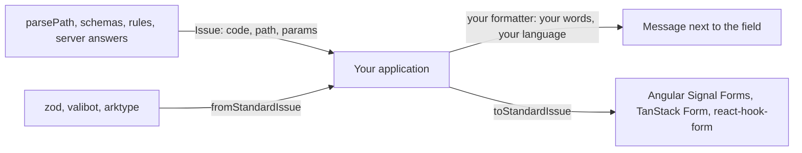

# Yaltaan guide

Yaltaan gives an application the few building blocks the platform lacks, all speaking the same language: an operation that can fail returns a `Result`, a failure is an `Issue` with a stable code, and every issue says where it is with a `Path`. A parser, a schema, a business rule and a server answer then fail the same way, and one piece of code shows all their errors.

## Available today in `@yaltaan/core`

| Page | Import | What you get | Instead of |
|---|---|---|---|
| [Results](result.md) | `@yaltaan/core/result` | Return an expected failure as a value, never as an exception. | `try`/`catch` around code that fails on bad input, `null` that hides why. |
| [Paths](path.md) | `@yaltaan/core/path` | Name a place in a structure, read and write its text form safely, refuse paths that would pollute a prototype. | Splitting `'a.b[0]'` by hand, `lodash.toPath`. |
| [Deep equality](equal.md) | `@yaltaan/core/equal` | Tell whether two values hold the same data: objects, arrays, `Map`, `Set`, dates, typed arrays, Temporal objects, cycles included. | `JSON.stringify(a) === JSON.stringify(b)`, `lodash.isEqual`, `util.isDeepStrictEqual` outside Node. |
| [Selecting fields](object.md) | `@yaltaan/core/object` | Keep, drop or hide fields of an object by a mask the compiler checks, nested records and arrays included, without polluting a prototype. | `lodash.pick`/`omit` with text paths, a loop per array, a log line that leaks a renamed secret. |
| [Issues](issue.md) | `@yaltaan/core/issue` | One error shape for everything, your own messages in your own languages, and the bridge to Standard Schema form engines. | One error format per library, and the glue code between them. |

Every export is `@experimental` until the contracts are frozen: it may change in a minor version, and the [changelog](../../../CHANGELOG.md) says so in bold.

## Principles you can rely on

- **Nothing runs on import.** Each sub-path is imported on its own, and an application ships only the functions it uses.
- **No exception for an expected failure.** An exception means a bug in the calling code (a wrong argument type, an impossible option).
- **Bounded on untrusted input.** Functions that read text from outside limit its length and depth by default, and say where it breaks.
- **No message in the library.** Codes and data only: the words belong to the application, in every language it speaks.
