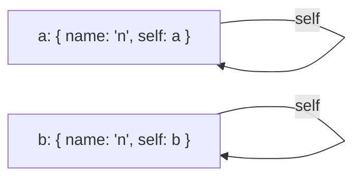

# Deep equality: do two values hold the same data?

`import { equal, type EqualOptions } from '@yaltaan/core/equal';`

## The problem

`===` tells whether two objects are the same object, not whether they hold the same data: the form's initial values and its current values are two objects even when the user changed nothing. `JSON.stringify(a) === JSON.stringify(b)` depends on the order of the keys, loses dates, `Map`, `Set`, `undefined` and `NaN`, and never ends on a structure that contains itself. Node's `util.isDeepStrictEqual` does not exist in the browser.

## Comparing two values

```ts
import { equal } from '@yaltaan/core/equal';

const saved = { name: 'Ada', tags: ['admin'], since: new Date(0) };
const current = { since: new Date(0), tags: ['admin'], name: 'Ada' };
equal(saved, current); // → true
equal(saved, { ...current, tags: ['admin', 'audit'] }); // → false
equal({ total: Number.NaN }, { total: Number.NaN }); // → true
```

The order of the keys never matters; the order of array elements does.

## What is compared, and how

| Value | Equal when |
|---|---|
| Primitives | They are the same by SameValueZero: `NaN` equals `NaN`, `0` equals `-0` (see below to tell zeros apart). |
| Plain objects (and objects from `Object.create(null)`) | They have the same own enumerable string keys, holding equal values. A key holding `undefined` is still a key. |
| Arrays | Same length, equal elements at each index. A hole differs from `undefined`. |
| `Map` | Same size, the same keys (as `has` finds them), equal values. |
| `Set` | Same size, the same elements (as `has` finds them). |
| `Date` | Same time value; two invalid dates are equal. |
| Typed arrays (`Uint8Array`…) | Same type, same length, equal numbers. |
| Temporal objects | Their own `equals` says so; a `Temporal.Duration`, which has none, has the same ten fields. |
| Anything else: class instances, functions, `RegExp`, `ArrayBuffer`… | They are the same object. |

A `Set` holds objects by identity, so two sets of objects are equal only if they hold the same objects: this is what `Set` itself means by "the same element".

```ts
import { equal } from '@yaltaan/core/equal';

equal(new Map([['fr', { label: 'Français' }]]), new Map([['fr', { label: 'Français' }]])); // → true
equal(new Set(['a', 'b']), new Set(['b', 'a'])); // → true
equal(new Set([{ id: 1 }]), new Set([{ id: 1 }])); // → false
equal({ draft: undefined }, {}); // → false
```

A class instance is compared by identity because only its class knows what makes two instances the same: call its own method, or compare the data it holds.

## Options

```ts
import { equal } from '@yaltaan/core/equal';

equal(0, -0); // → true
equal(0, -0, { equality: 'SameValue' }); // → false
const id = Symbol('id');
equal({ [id]: 1 }, { [id]: 2 }); // → true
equal({ [id]: 1 }, { [id]: 2 }, { symbols: true }); // → false
```

- `equality: 'SameValue'` compares primitives as `Object.is` does, so `0` and `-0` differ (useful for a value that is divided by later).
- `symbols: true` compares the own enumerable symbol keys of plain objects too; by default they are ignored, as by every object function of Yaltaan.

## Structures that contain themselves

Two values are equal when walking them side by side never finds a difference. A structure that refers to itself is therefore compared without looping forever, and a branch that several places share is compared once.



```ts
import { equal } from '@yaltaan/core/equal';

const a: Record<string, unknown> = { name: 'n' };
a['self'] = a;
const b: Record<string, unknown> = { name: 'n' };
b['self'] = b;
equal(a, b); // → true
```

Very deep structures (tens of thousands of levels) are compared without overflowing the call stack.

## What it costs

`equal` alone weighs under 1 kB minified and compressed with brotli. Comparing two small values (a form's worth of data) allocates no memory table; a table of the pairs already compared appears only past a few dozen objects, where it starts saving time.
