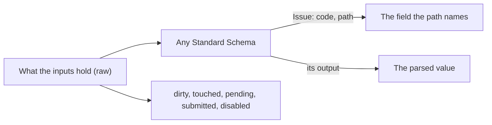

# Forms: values, issues and states that follow themselves

`import { createForm, field, group } from '@yaltaan/form';`

## The problem

A form keeps more than values: what the user changed, which fields they visited, whether they already tried to submit, which field is disabled, what a slow server check has not answered yet, and each error beside its field. Kept by hand, every one of these is a flag someone forgets to update, and a field that shows an error it no longer has.



## What you write

Describe the fields and the groups, then build the form. A schema reads a node's raw value: put one on the whole form, on a group or on a field. Each issue goes to the deepest node its path names.

```ts
import { createForm, field, group } from '@yaltaan/form';
import { object, string } from '@yaltaan/schema';

const form = createForm(
  group(
    {
      name: field('', { schema: string({ minLength: 2 }) }),
      address: group({ city: field(''), zip: field('') }),
    },
    { schema: object({ name: string(), address: object({ city: string({ minLength: 1 }), zip: string() }) }) },
  ),
);

const { name, address } = form.children;
name.set('Ada');
address.children.city.issues.get(); // → [{ code: 'schema.too_short', path: ['address', 'city'], params: { length: 0, minimum: 1 } }]
address.set({ city: 'Paris', zip: '75001' });
form.raw.get(); // → { name: 'Ada', address: { city: 'Paris', zip: '75001' } }
form.parsed.get(); // → { ok: true, value: { name: 'Ada', address: { city: 'Paris', zip: '75001' } } }
```

Every value and state is a node of the form's graph, with `get()` and `subscribe(listener)`, the contract of React's `useSyncExternalStore`, which converts to an Angular signal or a Vue ref as the [reactive values](reactive.md) page shows.

## The states

| State | Of a field | Of a group |
|---|---|---|
| `raw` | What its input holds. | The object of its children's raw values. |
| `parsed` | The read value: `{ ok: true, value }`, or `{ ok: false, error }` with the issues of the node and of everything below, while there is one or the node is pending. | The same, over its children. |
| `issues` | The issues placed on it, the outermost schema first. | Only those placed on the group itself. |
| `dirty` | Its raw value differs from its initial value, compared by `equal` (a list, a date by content). | A field below is dirty. |
| `touched` | `touch()` was called since its last reset. | A field below is touched. |
| `pending` | A schema that may place issues on it, its own, an ancestor's or a descendant's, has not answered yet. | The same. |
| `submitted` | `submit()` was called on the form since its last reset. | The same, one node for the whole form. |
| `disabled` | Its `disabled` condition holds, or its parent is disabled. | The same. |

`dirty` follows the value: set back to its initial value, a field is clean again, which is what an "unsaved changes" warning needs.

```ts
import { createForm, field, group } from '@yaltaan/form';

const form = createForm(group({ roles: field(['billing']), note: field('') }));
form.children.roles.set(['billing', 'sales']);
form.dirty.get(); // → true
form.children.roles.set(['billing']);
form.dirty.get(); // → false
```

## Writing, resetting, submitting

- `set(raw)` writes a field, or every field of a group from the object given, each value read once, in one batch; a group given anything else than an object throws a `TypeError` and writes nothing.
- `touch()` marks a field, or every field of a group, as touched: call it when an input loses focus.
- `reset()` gives back the initial values and marks untouched; `reset(raw)` makes `raw` the new initial value first, for instance after a save (`reset(undefined)` is `reset()`). On the root, it also clears `submitted`.
- `submit()` touches every field, marks the form as submitted, and returns its parsed value: send it when it is `ok`.

```ts
import { createForm, field, group } from '@yaltaan/form';
import { string } from '@yaltaan/schema';

const form = createForm(group({ email: field('', { schema: string({ minLength: 3 }) }) }));
form.submit().ok; // → false
form.children.email.touched.get(); // → true
form.children.email.set('ada@example.org');
form.submit(); // → { ok: true, value: { email: 'ada@example.org' } }
form.reset(form.raw.get());
form.dirty.get(); // → false
form.submitted.get(); // → false
```

## A field disabled by others

A condition names the paths it reads, from the root of the form, and says whether the node is disabled. Everything below a disabled group is disabled too.

```ts
import { createForm, field, group } from '@yaltaan/form';

const form = createForm(
  group({
    sameAsHeadOffice: field(true),
    billing: group({ city: field('') }, { disabled: { reads: [['sameAsHeadOffice']], when: (same) => same === true } }),
  }),
);
form.children.billing.children.city.disabled.get(); // → true
form.children.sameAsHeadOffice.set(false);
form.children.billing.children.city.disabled.get(); // → false
```

For now `disabled` changes nothing else: the issues of a disabled node still count, and its value stays in the parsed value.

## A schema that answers later

A Standard Schema may answer with a promise, a server check for instance. The nodes it may place issues on are `pending` until it answers, and their parsed value is not `ok` meanwhile. An answer for a value the user has since replaced is never delivered, whatever order the answers come in.

```ts
import { createForm, field } from '@yaltaan/form';
import type { StandardSchema } from '@yaltaan/schema';

const taken: StandardSchema<unknown, string> = {
  '~standard': {
    version: 1,
    vendor: 'app',
    validate: async (value) =>
      value === 'ada' ? { issues: [{ message: 'This name is taken' }] } : { value: String(value) },
  },
};

const login = createForm(field('ada', { schema: taken }));
login.pending.get(); // → true
await new Promise<void>((resolve) => {
  const stop = login.pending.subscribe(() => {
    stop();
    resolve();
  });
});
login.pending.get(); // → false
login.issues.get().map((issue) => issue.params?.['message']); // → ['This name is taken']
```

A promise that rejects, a server that cannot be reached for instance, places `form.validation_failed` on the node, with the reason as `cause`: the parsed value is not `ok`, and the form has an issue to show. So does a schema that fails without an issue.

An issue of another engine has the code `issue.external`, with its message in `params.message`; a schema of `@yaltaan/schema` keeps its own codes and data, for your formatter.

## Recipe: show an error accessibly

Show a field's issues once it was touched or the form submitted, through your formatter. The markup is yours; keep the message tied to its input and announced, never carried by colour alone: `aria-invalid="true"` on the input while there is an error, `aria-describedby` pointing at the message, and the message in a live region.

```ts
import { createForm, field, group, type FormNode } from '@yaltaan/form';
import type { Issue } from '@yaltaan/core/issue';
import { string } from '@yaltaan/schema';

const words = (issue: Issue): string => (issue.code === 'schema.too_short' ? 'Too short' : issue.code);

function shown(node: FormNode<unknown, unknown>): string[] {
  return node.touched.get() || node.submitted.get() ? node.issues.get().map(words) : [];
}

const form = createForm(group({ name: field('', { schema: string({ minLength: 2 }) }) }));
shown(form.children.name); // → []
form.children.name.touch();
shown(form.children.name); // → ['Too short']
```
