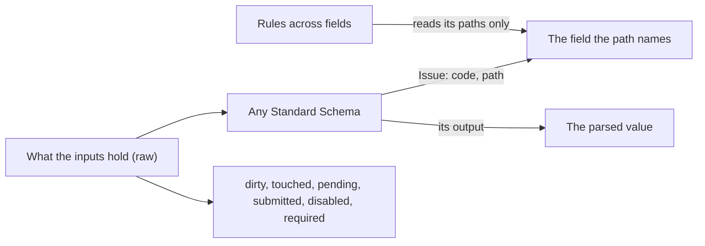

# Forms: values, issues and states that follow themselves

`import { createForm, field, group } from '@yaltaan/form';`

## The problem

A form keeps more than values: what the user changed, which fields they visited, whether they already tried to submit, which field is disabled, what a slow server check has not answered yet, and each error beside its field. Kept by hand, every one of these is a flag someone forgets to update, and a field that shows an error it no longer has.



## What you write

Describe the fields and the groups, then build the form. A schema reads a node's raw value: put one on the whole form, on a group or on a field. Each issue goes to the deepest node its path names.

```ts
import { createForm, field, group } from '@yaltaan/form';
import { object, string } from '@yaltaan/schema';

const form = createForm(
  group(
    {
      name: field('', { schema: string({ minLength: 2 }) }),
      address: group({ city: field(''), zip: field('') }),
    },
    { schema: object({ name: string(), address: object({ city: string({ minLength: 1 }), zip: string() }) }) },
  ),
);

const { name, address } = form.children;
name.set('Ada');
address.children.city.issues.get(); // → [{ code: 'schema.too_short', path: ['address', 'city'], params: { length: 0, minimum: 1 } }]
address.set({ city: 'Paris', zip: '75001' });
form.raw.get(); // → { name: 'Ada', address: { city: 'Paris', zip: '75001' } }
form.parsed.get(); // → { ok: true, value: { name: 'Ada', address: { city: 'Paris', zip: '75001' } } }
```

Every value and state is a node of the form's graph, with `get()` and `subscribe(listener)`, the contract of React's `useSyncExternalStore`, which converts to an Angular signal or a Vue ref as the [reactive values](reactive.md) page shows.

## The states

| State | Of a field | Of a group |
|---|---|---|
| `raw` | What its input holds. | The object of its children's raw values. |
| `parsed` | The read value: `{ ok: true, value }`, or `{ ok: false, error }` with the issues of the node and of everything below, while one is not a warning or the node is pending. | The same, over its children. |
| `issues` | The issues placed on it, the outermost node first, a node's schema before its rules. | Only those placed on the group itself. |
| `required` | A rule of its own or of an ancestor requires it. | The same. |
| `dirty` | Its raw value differs from its initial value, compared by `equal` (a list, a date by content). | A field below is dirty. |
| `touched` | `touch()` was called since its last reset. | A field below is touched. |
| `pending` | A schema that may place issues on it, its own, an ancestor's or a descendant's, has not answered yet. | The same. |
| `submitted` | `submit()` was called on the form since its last reset. | The same, one node for the whole form. |
| `disabled` | Its `disabled` condition holds, or its parent is disabled. | The same. |

`dirty` follows the value: set back to its initial value, a field is clean again, which is what an "unsaved changes" warning needs.

```ts
import { createForm, field, group } from '@yaltaan/form';

const form = createForm(group({ roles: field(['billing']), note: field('') }));
form.children.roles.set(['billing', 'sales']);
form.dirty.get(); // → true
form.children.roles.set(['billing']);
form.dirty.get(); // → false
```

## Writing, resetting, submitting

- `set(raw)` writes a field, or every field of a group from the object given, each value read once, in one batch; a group given anything else than an object throws a `TypeError` and writes nothing.
- `touch()` marks a field, or every field of a group, as touched: call it when an input loses focus.
- `reset()` gives back the initial values and marks untouched; `reset(raw)` makes `raw` the new initial value first, for instance after a save (`reset(undefined)` is `reset()`). On the root, it also clears `submitted`.
- `submit()` touches every field, marks the form as submitted, and returns its parsed value: send it when it is `ok`.

```ts
import { createForm, field, group } from '@yaltaan/form';
import { string } from '@yaltaan/schema';

const form = createForm(group({ email: field('', { schema: string({ minLength: 3 }) }) }));
form.submit().ok; // → false
form.children.email.touched.get(); // → true
form.children.email.set('ada@example.org');
form.submit(); // → { ok: true, value: { email: 'ada@example.org' } }
form.reset(form.raw.get());
form.dirty.get(); // → false
form.submitted.get(); // → false
```

## A field disabled by others

A condition names the paths it reads, from the root of the form, and says whether the node is disabled. Everything below a disabled group is disabled too.

```ts
import { createForm, field, group } from '@yaltaan/form';

const form = createForm(
  group({
    sameAsHeadOffice: field(true),
    billing: group({ city: field('') }, { disabled: { reads: [['sameAsHeadOffice']], when: (same) => same === true } }),
  }),
);
form.children.billing.children.city.disabled.get(); // → true
form.children.sameAsHeadOffice.set(false);
form.children.billing.children.city.disabled.get(); // → false
```

For now `disabled` changes nothing else: the issues of a disabled node still count, and its value stays in the parsed value.

## Lists whose rows move

`array(element, options)` describes a list: each item is a node built from `element`, a field, a group or another array. An item keeps a key for as long as it lives, and its path ends with `{ key }`, so that its states and the issues placed on it follow it when it moves. The form numbers its items from 0 in the order it builds them. With `identity`, the path of a business key inside an item, writes and issues find an item by the key its value holds.

```ts
import { array, createForm, field, group } from '@yaltaan/form';
import { array as list, object, string } from '@yaltaan/schema';

const form = createForm(
  group(
    { contacts: array(group({ email: field('') }), { initial: [{ email: 'ada@example.org' }, { email: '' }] }) },
    { schema: object({ contacts: list(object({ email: string({ minLength: 3 }) })) }) },
  ),
);
const contacts = form.children.contacts;
const empty = contacts.items.get()[1]!;
empty.children.email.issues.get().map((issue) => issue.path); // → [['contacts', { key: 1 }, 'email']]
contacts.move(empty, 0);
empty.children.email.issues.get().map((issue) => issue.path); // → [['contacts', { key: 1 }, 'email']]
contacts.dirty.get(); // → true
const added = contacts.insert(2, { email: 'grace@example.org' });
added.path; // → ['contacts', { key: 2 }]
contacts.remove(contacts.items.get()[1]!); // → true
contacts.raw.get(); // → [{ email: '' }, { email: 'grace@example.org' }]
```

- `insert(index, raw?)` builds an item from `raw`, or from the initial value of the element, and returns it; `remove(item)` and `move(item, index)` return whether the item was there. An index out of range throws a `RangeError`, a value that does not fit the element a `TypeError`: nothing is written.
- `set(list)` keeps the items by position, or with `identity` the item that holds the key of each value; a value left builds an item, an item left is removed. `reset()` gives back the items of the last reset, in their order.
- `dirty` compares the raw value of the list with its initial one: a row moved makes it dirty, moved back it is not.
- A schema of the list names an item by its index in the value it read: the issue goes to that item, its index replaced by the item's `{ key }`. A schema of the element, on each item, is not asked again when the item moves.
- A condition inside an item reads a field of the same item through `{ key: undefined }`, which `@yaltaan/rules` names `anyElement`: `{ reads: [['contacts', { key: undefined }, 'primary']], when: (primary) => primary === true }`.
- An array holds at most `maxLength` items, 1,000 by default, and one write reads at most `maxItems` items of the whole form, 10,000 by default (an option of `createForm`): past either, the write throws a `RangeError` and writes nothing.

## A schema that answers later

A Standard Schema may answer with a promise, a server check for instance. The nodes it may place issues on are `pending` until it answers, and their parsed value is not `ok` meanwhile. An answer for a value the user has since replaced is never delivered, whatever order the answers come in.

```ts
import { createForm, field } from '@yaltaan/form';
import type { StandardSchema } from '@yaltaan/schema';

const taken: StandardSchema<unknown, string> = {
  '~standard': {
    version: 1,
    vendor: 'app',
    validate: async (value) =>
      value === 'ada' ? { issues: [{ message: 'This name is taken' }] } : { value: String(value) },
  },
};

const login = createForm(field('ada', { schema: taken }));
login.pending.get(); // → true
await new Promise<void>((resolve) => {
  const stop = login.pending.subscribe(() => {
    stop();
    resolve();
  });
});
login.pending.get(); // → false
login.issues.get().map((issue) => issue.params?.['message']); // → ['This name is taken']
```

A promise that rejects, a server that cannot be reached for instance, places `form.validation_failed` on the node, with the reason as `cause`: the parsed value is not `ok`, and the form has an issue to show. So does a schema that fails without an issue.

An issue of another engine has the code `issue.external`, with its message in `params.message`; a schema of `@yaltaan/schema` keeps its own codes and data, for your formatter.

## Rules across fields

`rules` gives a field, a group or an array the rules of [`@yaltaan/rules`](rules.md), their paths from that node. The form reads each rule as a node of its own, which reads the values of the paths the rule declares and nothing else: it is checked again only once one of them changes, and only when a state that needs it is read. Writing a contact's name checks no rule that reads emails. Its issues keep their code and their data, on the node their path names, after the issues of that node's schema; `required` says which nodes a rule requires.

```ts
import { array, createForm, field, group } from '@yaltaan/form';
import { requiredIf, unique } from '@yaltaan/rules';

const form = createForm(
  group(
    {
      country: field('FR'),
      siren: field<string | undefined>(undefined),
      contacts: array(group({ key: field(''), name: field(''), email: field('') }), {
        identity: ['key'],
        initial: [
          { key: 'c1', name: 'Claire', email: 'claire@example.org' },
          { key: 'c2', name: 'Karim', email: 'karim@example.org' },
        ],
      }),
    },
    {
      rules: [
        requiredIf({ reads: [['country']], when: (country) => country === 'FR' }, [['siren']]),
        unique(['contacts'], ['email'], { identity: ['key'] }),
      ],
    },
  ),
);
const { siren, contacts } = form.children;
siren.required.get(); // → true
siren.issues.get().map((issue) => issue.code); // → ['rules.required_if']
const [claire, karim] = contacts.items.get();
karim!.children.email.set('claire@example.org');
claire!.children.email.issues.get().map((issue) => issue.code); // → ['rules.unique']
form.children.country.set('DE');
siren.required.get(); // → false
```

A rule reads the raw values as `checkRules` would, so that the form and a server running the same rules agree: a sub-form left empty is an object, not a blank, and `requiredIf(…, [['billing']])` does not mark it; require its fields instead. An item named by `{ key }` in an issue of `each` or `unique` is found by the key its value holds when the array keeps its items by the same `identity`; otherwise no item holds that key, and the issue stays on the list. An index in a path the rule declares reads every item, since which item stands there changes with each move. A warning of a rule is shown, and blocks nothing: neither the parsed value nor a validator. An issue of a rule on a node or below it holds its validator back, as a schema's does.

## A check only the server can make

`validate` gives a field, a group or an array a check of your application's own, a server's answer for instance. It receives the node's raw value and `{ signal, path }`, and returns the issues it found, their paths from the node, or a promise of them; an empty list when there is none. A run starts only once the schemas and the rules have nothing against the value: no schema of the node, of a node below it or of an ancestor is still to answer, nor has a schema or a rule placed an issue on the node or below, a warning aside. So the server is not asked about a SIREN the step's schema rejects.

```ts
import type { Issue } from '@yaltaan/core/issue';
import { createForm, field, group, type Validation } from '@yaltaan/form';
import { object, string } from '@yaltaan/schema';

// Stands for your server: each request waits for its answer. In an application, pass the signal to fetch.
const requests: { readonly siren: string; readonly signal: Validation['signal']; answer(taken: boolean): void }[] = [];
const registered = (siren: string, signal: Validation['signal']): Promise<boolean> =>
  new Promise((answer) => requests.push({ siren, signal, answer }));

const company = createForm(
  group(
    {
      siren: field('', {
        validate: async (siren, { signal }): Promise<Issue[]> =>
          (await registered(siren, signal)) ? [{ code: 'app.siren_registered', path: [] }] : [],
      }),
    },
    { schema: object({ siren: string({ pattern: /^\d{9}$/, maxLength: 9 }) }) },
  ),
);
const { siren } = company.children;
siren.set('12345');
siren.pending.get(); // → false
requests.length; // → 0
siren.set('123456789');
siren.pending.get(); // → true
requests.map((request) => request.siren); // → ['123456789']
requests[0]!.answer(true);
await new Promise<void>((resolve) => {
  const stop = siren.pending.subscribe(() => {
    stop();
    resolve();
  });
});
siren.issues.get().map((issue) => issue.code); // → ['app.siren_registered']
```

Each run has its own `signal`, aborted when the run stops counting before it answered: when the node is read after its value changed, when a schema or a rule places an issue on it, or when the node leaves the form, an item removed from its list; pass it to `fetch` so that the request stops. A schema that has yet to answer, after a change elsewhere, neither starts nor stops a run: typing in another field asks the server nothing again. Whatever the validator does with its signal, an answer counts only while its run is the node's last and the node is in the form. A promise that rejects places `form.validation_failed` on the node, the reason as `cause`.

- **Wait before asking.** Each new value aborts the run before it, so a validator that first awaits a delay honouring its signal asks the server only once the user stops typing; the node is `pending` during the delay.
- **A form you discard.** Combine the signal with yours, `AbortSignal.any([signal, destroyed])`, to stop what is in flight when the component goes away.
- **Inside a validator**, read only its arguments: a computation of the form calls it, so reading a node of the form there throws a `TypeError`. What listens to its signal runs later, out of any computation, and may read the form.

## Recipe: show an error accessibly

Show a field's issues once it was touched or the form submitted, through your formatter. The markup is yours; keep the message tied to its input and announced, never carried by colour alone: `aria-invalid="true"` on the input while there is an error, `aria-describedby` pointing at the message, and the message in a live region.

```ts
import { createForm, field, group, type FormNode } from '@yaltaan/form';
import type { Issue } from '@yaltaan/core/issue';
import { string } from '@yaltaan/schema';

const words = (issue: Issue): string => (issue.code === 'schema.too_short' ? 'Too short' : issue.code);

function shown(node: FormNode<unknown, unknown>): string[] {
  return node.touched.get() || node.submitted.get() ? node.issues.get().map(words) : [];
}

const form = createForm(group({ name: field('', { schema: string({ minLength: 2 }) }) }));
shown(form.children.name); // → []
form.children.name.touch();
shown(form.children.name); // → ['Too short']
```
