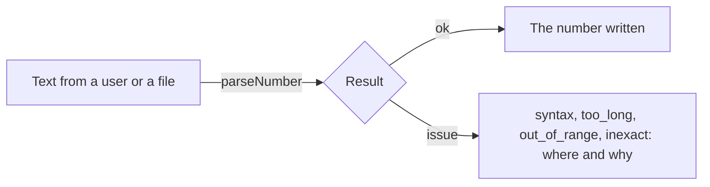

# Numbers: read strictly, bound, compare, round, convert

`import { parseNumber, clamp, inRange, approxEqual, round, bigIntToNumber, numberToBigInt } from '@yaltaan/core/number';`

## The problem

`parseFloat('12abc')` gives 12, `Number('')` gives 0 and `Number(' 12 ')` gives 12: a form field that holds a typo becomes a number in silence. `Number('9007199254740993')` gives 9007199254740992, an identifier quietly changed. A French user who types `1,5` in an English form gets 15 from code that drops the group separators. `Math.round(1.005 * 100) / 100` gives 1, because `1.005 * 100` is 100.49999999999999. And `Number(2n ** 53n + 1n)` rounds a `bigint` without a word.



## Reading a number

```ts
import { parseNumber } from '@yaltaan/core/number';

parseNumber('-1234.5'); // → { ok: true, value: -1234.5 }
parseNumber('12abc'); // → { ok: false, error: { code: 'number.syntax', path: [], params: { index: 2 } } }
parseNumber(''); // → { ok: false, error: { code: 'number.syntax', path: [], params: { index: 0 } } }
parseNumber('1 234,5', { decimal: ',', grouping: ' ' }); // → { ok: true, value: 1234.5 }
parseNumber('1,5', { grouping: ',' }).ok; // → false
parseNumber('9007199254740993'); // → { ok: false, error: { code: 'number.inexact', path: [], params: { digits: 16 } } }
```

The text is read whole: no whitespace, no `+`, no `0x`, no `Infinity`, digits on both sides of the decimal separator. Separators are explicit: `'.'` for the decimal by default and no group separator, so `1,5` is never read as 15 by accident. With a group separator, groups are of three digits from the decimal separator, the first not starting with 0, or there are none: `0,123` is a decimal of another locale, never 123. A text that says more than a number holds is refused: too large, too small, or more significant digits than are kept.

To read what a locale writes, take its separators from `Intl.NumberFormat`:

```ts
import { parseNumber } from '@yaltaan/core/number';

const parts = new Intl.NumberFormat('fr-FR').formatToParts(1234.5);
const separator = (type: string): string => parts.find((part) => part.type === type)!.value;
parseNumber('1\u202F234,5', { decimal: separator('decimal'), grouping: separator('group') }); // → { ok: true, value: 1234.5 }
```

French writes its groups with a narrow no-break space (U+202F); a user may type an ordinary space: replace it before reading if the field allows both. Every number written by `String(x)`, or by `Intl.NumberFormat` with `maximumSignificantDigits: 17` in a locale whose digits are ASCII and whose groups are of three, reads back to the same number.

## Bounds

```ts
import { clamp, inRange } from '@yaltaan/core/number';

clamp(12, { min: 0, max: 10 }); // → 10
clamp(-3, { min: 0 }); // → 0
inRange(10, { min: 0, max: 10 }); // → true
inRange(10, { min: 0, max: 10, exclusive: 'max' }); // → false
```

Bounds are named, each optional, and the range is closed unless `exclusive` says `'min'`, `'max'` or `'both'`. A bound that is `NaN`, or a `min` above `max`, is an error of the calling code: a `RangeError`.

## Nearly equal

```ts
import { approxEqual } from '@yaltaan/core/number';

0.1 + 0.2 === 0.3; // → false
approxEqual(0.1 + 0.2, 0.3, { relative: 1e-9 }); // → true
approxEqual(1e-12, 0, { relative: 1e-9 }); // → false
approxEqual(1e-12, 0, { relative: 1e-9, absolute: 1e-9 }); // → true
```

There is no default tolerance: one that fits numbers near 1 is wrong near 0 or near a billion. A relative tolerance is a fraction, from 0 to 1, of the larger of the two numbers; near zero, add an absolute one.

## Rounding

```ts
import { round } from '@yaltaan/core/number';

round(1.005, { digits: 2, mode: 'halfExpand' }); // → 1.01
round(2.345, { digits: 2, mode: 'halfEven' }); // → 2.34
round(-2.5, { mode: 'halfCeil' }); // → -2
round(1234, { digits: -2, mode: 'floor' }); // → 1200
```

`round` rounds the decimal that `String` writes, the one a person reads, as `Intl.NumberFormat` rounds it: `1.005` is 1.01, where `toFixed` gives `'1.00'`. The mode is always given, under the names of `Intl.NumberFormat`: `ceil`, `floor`, `expand` (away from zero), `trunc` (toward zero), and `halfCeil`, `halfFloor`, `halfExpand`, `halfTrunc`, `halfEven` for the nearest, a tie going up, down, away from zero, toward zero or to the even digit. The result is the nearest number to the rounded decimal: for money, compute in integers of cents or with a decimal library.

## Between `number` and `bigint`

```ts
import { bigIntToNumber, numberToBigInt } from '@yaltaan/core/number';

bigIntToNumber(2n ** 60n); // → { ok: true, value: 1152921504606846976 }
bigIntToNumber(2n ** 53n + 1n).ok; // → false
numberToBigInt(2 ** 60); // → { ok: true, value: 1152921504606846976n }
numberToBigInt(1.5); // → { ok: false, error: { code: 'number.not_integer', path: [] } }
```

Each conversion is exact or says why not: a `bigint` between two numbers is `number.inexact`, one beyond them `number.out_of_range`, and a fraction, `NaN` or an infinity has no `bigint`.

## Good to know

- `parseNumber` reads at most 1,000 code units by default (`maxLength`), in one pass and without a regular expression: its time is linear in the length.
- `-0` reads as `-0`, and `round` keeps the sign of a value rounded to zero: `round(-0.4, { mode: 'halfExpand' })` is `-0`.
- Digits other than ASCII (Arabic-Indic, full width) and the grouping of India (`12,34,567`) are not read yet.
