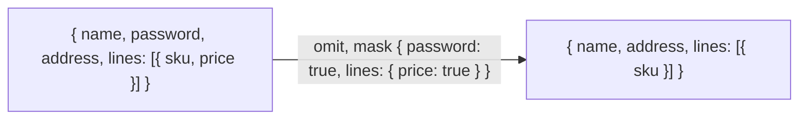

# Selecting fields: pick, omit and redact by a mask

`import { pick, omit, redact, type Mask } from '@yaltaan/core/object';`

## The problem

An application keeps rewriting the same three functions: keep only some fields of an object (what a screen or an API answer needs), drop some (a password before sending a user to the browser), hide some (a card number before writing a log). The usual versions take a list of key names, one level deep: a nested field takes one call per level, a field inside each element of an array takes a loop, and a field renamed in the model is silently no longer dropped. A secret then leaks into a log, and nothing fails.

## A mask, shaped like the value

A mask names fields the way the value nests them: `true` takes a field whole, a nested mask walks into it, and a mask on an array applies to each of its elements.



```ts
import { omit, pick, redact } from '@yaltaan/core/object';

const user = {
  name: 'Ada',
  password: 's3cret',
  address: { city: 'Paris', zip: '75001' },
  lines: [{ sku: 'a', price: 3 }],
};
omit(user, { password: true, lines: { price: true } }); // → { name: 'Ada', address: user.address, lines: [{ sku: 'a' }] }
pick(user, { name: true, address: { city: true } }); // → { name: 'Ada', address: { city: 'Paris' } }
redact(user, { password: true }); // → { ...user, password: '***' }
redact(user, { password: true }, { replacement: null }); // → { ...user, password: null }
```

## The compiler checks every field

The keys of a mask are checked against the type of the value, at every depth and inside arrays. Your editor offers the real fields as you type, and a misspelt or renamed field is a compile error, even beside a correct one. The result has the type of what is left: after `omit(user, { password: true })`, reading `.password` does not compile.

```ts
import { omit, type Mask } from '@yaltaan/core/object';

interface User {
  readonly name: string;
  readonly password: string;
  readonly address: { readonly city: string };
}
const ada: User = { name: 'Ada', password: 's3cret', address: { city: 'Paris' } };

const safe = omit(ada, { password: true }); // → { name: 'Ada', address: { city: 'Paris' } }
// @ts-expect-error the password is no longer there
void safe.password;
// @ts-expect-error "passwrd" is no field of User, and the compiler says so
const wrong = (): unknown => omit(ada, { name: true, passwrd: true });
const reusable: Mask<User> = { address: { city: true } };
```

On a value whose type is `unknown` (data just parsed from JSON), any key goes; the functions still check at run time that the mask is made of `true` and plain objects.

## What is walked, and what is taken whole

| Value | What a mask does |
|---|---|
| Plain objects (and objects from `Object.create(null)`) | Selects among their own enumerable string keys; the copy keeps the prototype, so a dictionary without prototype stays one. |
| Arrays | Applies the mask to each element; holes stay holes. |
| Anything else: `Map`, `Set`, dates, class instances, functions… | Takes the value whole. The compiler only accepts `true` for a date or a `Map`. |

```ts
import { omit } from '@yaltaan/core/object';

const parsed = JSON.parse('{ "__proto__": { "isAdmin": true }, "name": "Ada" }') as unknown;
const copy = omit(parsed, {}); // → JSON.parse('{ "__proto__": { "isAdmin": true }, "name": "Ada" }')
(copy as { isAdmin?: boolean }).isAdmin; // → undefined
```

A `"__proto__"` key in the data stays an ordinary key of the copy: it never becomes its prototype, and nothing reaches `Object.prototype`, whatever the keys of the value or of the mask.

- A getter is read once, and only when its field is kept; what it throws reaches you unchanged.
- Symbol keys are ignored unless you pass `{ symbols: true }`, as for every object function of Yaltaan.
- What the mask does not walk into is shared with the value, not copied: `omit(user, { password: true }).address === user.address`.
- A mask may refer to itself, to walk a tree (`mask.children = mask`).

## Comparing only some fields

`equal` takes the same masks, to compare all the fields but some, or only some: see [deep equality](equal.md#comparing-only-some-fields).

## What it costs

`omit` alone weighs about 530 bytes minified and compressed with brotli, `pick`, `omit` and `redact` together about 630; es-toolkit's `omit`, which only drops keys one level deep, weighs 90, and its lodash-compatible `omit`, which walks nested paths, 2,741. Each call walks only as far as the mask goes, and reads each kept field once.
