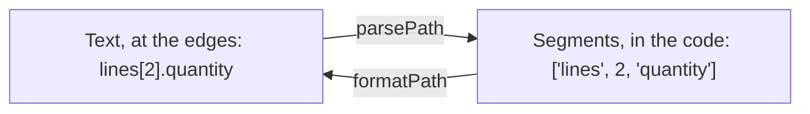

# Paths: naming a place in your data

`import { checkWritablePath, formatPath, parsePath, type Path } from '@yaltaan/core/path';`

## The problem

An error has to say which field it concerns: `lines[2].quantity`. That text comes from a form field name, a URL or a server answer, and splitting it by hand breaks on the first key that holds a dot or a bracket. Worse, a path read from outside and used to write (`user.__proto__.isAdmin`) can change every object of the application.

## Two forms, one path

Inside your code a path is an array of segments; text exists only where you exchange with the outside.



```ts
import { formatPath, parsePath } from '@yaltaan/core/path';

parsePath('lines[2].quantity'); // → { ok: true, value: ['lines', 2, 'quantity'] }
parsePath('lines[2]["unit price"]'); // → { ok: true, value: ['lines', 2, 'unit price'] }
formatPath(['lines', 2, 'unit price']); // → { ok: true, value: 'lines[2]["unit price"]' }
formatPath([]); // → { ok: true, value: '' }
```

## The text grammar

| You write | Segment | Example |
|---|---|---|
| A name made of ASCII letters, digits, `_` and `$`, not starting with a digit | the string | `lines`, `$id`, `_meta` |
| A whole number in brackets | the number | `[0]`, `[42]` |
| Any other key, as a JSON string in brackets | the string | `["unit price"]`, `["a.b"]`, `["3"]`, `["prénom"]` |

Each path has exactly one text form, so `formatPath` then `parsePath` always give back the same segments. Accents are written in quotes because which letters count as a name changes between JavaScript engines; quoting keeps the same text everywhere.

## Untrusted text is refused with a reason

A path that breaks the grammar is never guessed at: the issue says where it breaks.

```ts
import { parsePath } from '@yaltaan/core/path';

parsePath('lines.2'); // → { ok: false, error: { code: 'path.syntax', path: [], params: { index: 6 } } }
parsePath('a.b.c', { maxDepth: 2 }); // → { ok: false, error: { code: 'path.too_deep', path: [], params: { maximum: 2 } } }
```

By default a text holds at most 4,096 characters and 64 segments, and reading it takes a time proportional to its length: a hostile text cannot freeze the page or the server. Raise the limits with `maxLength` and `maxDepth` only for text you trust.

## Before writing through a path from outside

`__proto__`, `constructor` and `prototype` lead to objects that every other object shares. `checkWritablePath` refuses them before you write anything.

```ts
import { checkWritablePath } from '@yaltaan/core/path';

const path = ['user', '__proto__', 'isAdmin'];
checkWritablePath(path); // → { ok: false, error: { code: 'path.forbidden_segment', path, params: { index: 1, segment: '__proto__' } } }
checkWritablePath(['user', 'name']); // → { ok: true, value: ['user', 'name'] }
```

## Following a list element when it moves: `{ key }`

An index changes when the list is sorted or an element is removed; an error attached to `lines[1]` would then show on the wrong line. A `{ key }` segment names the element by its own identifier instead, so what is attached to it follows it.

| Order of the list | Error attached to `['lines', 1, 'quantity']` | Error attached to `['lines', { key: 'b2' }, 'quantity']` |
|---|---|---|
| `a7`, `b2` | line `b2`: right | line `b2`: right |
| `b2`, `a7` after sorting | line `a7`: wrong | line `b2`: right |

```ts
import { formatPath, type Path } from '@yaltaan/core/path';

const quantityOfB2: Path = ['lines', { key: 'b2' }, 'quantity'];
formatPath(quantityOfB2); // → { ok: false, error: { code: 'path.not_textual', path: quantityOfB2, params: { index: 1 } } }
```

A `{ key }` segment has no text form; to hand it to a form engine that only knows indexes, convert the issue with [`toStandardIssue`](issue.md#to-a-form-engine-tostandardissue), which looks up the element's current index.

## Codes

The issues of this module (`path.syntax`, `path.too_long`, `path.too_deep`, `path.not_textual`, `path.forbidden_segment`) and their parameters are listed in the [registry of `@yaltaan/core`](../../issue-codes/core.md).
