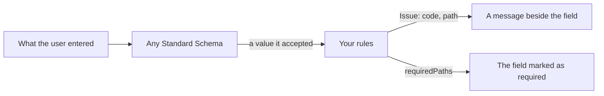

# Rules: what holds across fields

`import { allOrNone, anyElement, assertDeclaredReads, atLeast, checkRules, each, exactly, mutuallyExclusive, ordered, refine, requiredIf, requiredPaths, unique } from '@yaltaan/rules';`

## The problem

A schema reads one field at a time. What a form really requires runs across fields: a SIREN for a French company, a contract number and its date together or not at all, at least one billing contact, no two products with the same reference. Written as `if` statements after the schema, these rules know nothing of the form, repeat what makes a field required, and cannot be reused by another engine.



## What you write

Build rules with functions, and run them with `checkRules`: every issue, each on the field to mark. `requiredPaths` derives the fields these values require, which no rule ever writes.

```ts
import { allOrNone, atLeast, checkRules, mutuallyExclusive, ordered, requiredIf, requiredPaths } from '@yaltaan/rules';

const rules = [
  // A SIREN for a French company.
  requiredIf({ reads: [['country']], when: (country) => country === 'FR' }, [['siren']]),
  mutuallyExclusive([['siren'], ['foreignNumber']]),
  allOrNone([['contract'], ['signedOn']]),
  atLeast(1, [['phone'], ['email']]),
  ordered(['from'], ['to']),
];

const values = { country: 'FR', foreignNumber: 'X1', contract: 'C-1', phone: '01', from: '2026-11-02', to: '2026-01-01' };

checkRules(rules, values); // → [{ code: 'rules.required_if', path: ['siren'] }, { code: 'rules.all_or_none', path: ['signedOn'] }, { code: 'rules.ordered', path: ['to'] }]
requiredPaths(rules, values); // → [['siren'], ['signedOn']]
checkRules(rules, { country: 'DE', from: 1, to: 2, email: 'a@b' }); // → []
```

A rule holds no state and writes nothing. `requiredPaths` names a field only when the rule cannot hold without it: `atLeast(1, [a, b])` with both blank requires neither, and `checkRules` still marks both.

| Rule | What gets the issue |
|---|---|
| `requiredIf` | each blank field, while the condition holds |
| `allOrNone` | each blank field, when some are filled |
| `atLeast` | each blank field, or the list |
| `exactly` | each blank field under the count, each filled one over it, or the list |
| `mutuallyExclusive` | each filled field, when two or more are |
| `unique` | every element sharing a key |
| `ordered` | the end, when it comes before the start |

A field is blank when it is absent, `undefined`, `null`, an empty string or an empty array. `0` and `false` are values, and so is a string of spaces: a schema trims it first. A value is read through own keys only: a field named `toString` is blank unless the object holds its own. `ordered` compares numbers and bigints by value, dates by time and strings by code unit, the order of ISO 8601 dates; `compare` is for what else there is, such as Temporal. Two values it cannot compare give the issue: a rule that cannot tell does not pass.

## Lists

`each` applies rules to every element, as if the element were the values, and an issue comes back with the element's path in front; lists nest. `identity` names the field that holds an element's stable key: the path then says `{ key }`, and an issue follows its element when the list is reordered. A count over a list takes `{ list, at, where }`, and marks the list.

```ts
import { atLeast, checkRules, each, exactly, requiredIf, unique } from '@yaltaan/rules';

const lowerCase = (text: unknown): unknown => (typeof text === 'string' ? text.toLowerCase() : text);
const taxed = requiredIf({ reads: [['taxable']], when: (taxable) => taxable === true }, [['rate']]);

const rules = [
  each(['products'], [taxed], { identity: ['key'] }),
  unique(['products'], ['reference'], { by: lowerCase, identity: ['key'] }),
  atLeast(1, { list: ['contacts'], at: ['billing'], where: (billing) => billing === true }),
  exactly(1, { list: ['contacts'], at: ['primary'], where: (primary) => primary === true }),
];

const values = {
  products: [
    { key: 'p1', reference: 'A-1', taxable: true },
    { key: 'p2', reference: 'a-1', taxable: false },
  ],
  contacts: [{ billing: true, primary: false }],
};

checkRules(rules, values); // → [{ code: 'rules.required_if', path: ['products', { key: 'p1' }, 'rate'] }, { code: 'rules.unique', path: ['products', { key: 'p1' }, 'reference'] }, { code: 'rules.unique', path: ['products', { key: 'p2' }, 'reference'] }, { code: 'rules.exactly', path: ['contacts'], params: { expected: 1, count: 0 } }]
```

An element whose `identity` field is absent or blank is named by its index. A callback (`by`, `where`, `compare`) never meets a blank value, so that a row just added cannot make a validator throw, and what it receives is typed `unknown`, since a form may hold anything. `unique` compares by SameValueZero, a string on its first 16,000 code units, and a blank is not compared: a field still empty is another rule's to say.

## In any form engine

`refine` puts rules behind any Standard Schema: the schema reads first, and the rules only see a value it accepted. What comes back is a Standard Schema, asynchronous when the schema is, that Angular Signal Forms, TanStack Form or any other engine takes as it is.

```ts
import { atLeast, refine } from '@yaltaan/rules';
import { object, optional, string } from '@yaltaan/schema';

const contact = refine(object({ phone: optional(string()), email: optional(string()) }), [atLeast(1, [['phone'], ['email']])], {
  format: (issue) => `Check this field: ${issue.code}`,
});

contact['~standard'].validate({ phone: '01' }); // → { value: { phone: '01' } }
contact['~standard'].validate({}); // → { issues: [{ message: 'Check this field: rules.at_least', path: ['phone'] }, { message: 'Check this field: rules.at_least', path: ['email'] }] }
```

The message of an issue is its code until `format` gives it your words. A `warning` blocks nothing, and the interface has no other kind of issue, so it stays out, for `checkRules` to show. Standard Schema paths hold property names and indexes: a `{ key }` needs `resolveKey`, which receives the value of that read, or the issue stops at the list; so an engine that shows errors on list elements gets either `each` without `identity`, or `resolveKey`.

## A rule of your own

A rule is a plain object: what it reads, where it marks, and what it says of given values. In your tests, `assertDeclaredReads` runs it on a view of the values that notes each read and refuses each write, and throws if it read what it did not declare.

```ts
import { assertDeclaredReads, checkRules, each, type Rule } from '@yaltaan/rules';

const firstAboveMinimum: Rule = {
  reads: [['minimum'], ['tiers', 0, 'from']],
  targets: [['tiers', 0, 'from']],
  check: (values) => {
    const { minimum, tiers } = values as { minimum: number; tiers: readonly { from: number }[] };
    return (tiers[0]?.from ?? minimum) < minimum ? [{ code: 'app.first_tier', path: ['tiers', 0, 'from'] }] : [];
  },
};

const value = { minimum: 10, tiers: [{ from: 5 }] };

checkRules([firstAboveMinimum], value); // → [{ code: 'app.first_tier', path: ['tiers', 0, 'from'] }]
checkRules([each(['products'], [firstAboveMinimum])], { products: [value] }); // → [{ code: 'app.first_tier', path: ['products', 0, 'tiers', 0, 'from'] }]

assertDeclaredReads(firstAboveMinimum, value);
const liar: Rule = { reads: [['a']], targets: [], check: (values) => ((values as { b?: unknown }).b === 1 ? [] : []) };
let said = '';
try {
  assertDeclaredReads(liar, { b: 1 });
} catch (error) {
  said = String(error);
}
said; // → 'Error: the rule reads what it does not declare: b'
```

`assertDeclaredReads` sees what one run does: a branch these values do not take is not seen, nor what a closure reads, nor the inside of a `Date`, a `Map` or a class instance, nor a decision on a value a declared path only goes through. A built-in rule only meets the values of the paths it declares, and needs no such test.

## What an input can cost

A check holds at most 1,000 errors: it then adds `rules.too_many_issues`, at the root, and stops. A warning does not count, nor end the walk, and the first 1,000 are kept; `requiredPaths` stops at 1,000 paths and says nothing, since it only says what to show and `checkRules` decides. A list over 1,000,000 elements gets `rules.too_large`, and none of its elements is read. The rest of the work is linear in the elements of a value that shares no list, as JSON cannot, and the depth is that of your rules.

## See also

- [Issues](issue.md)
- [Schemas](schema.md)
- [Reference](../../reference/rules.md), [issue codes](../../issue-codes/rules.md)
- [Why it is built this way](../../adr/0034-rules-package.md)
