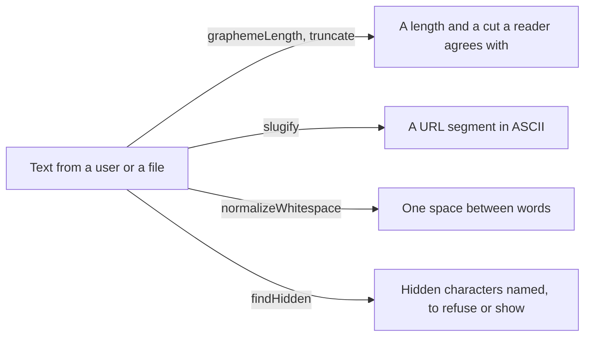

# Strings: graphemes, truncation, slugs, whitespace, hidden characters

`import { graphemeLength, truncate, slugify, normalizeWhitespace, findHidden } from '@yaltaan/core/string';`

## The problem

`length` counts code units, not what a reader sees: a family emoji is 8, a flag 4, an `e` followed by a combining accent 2. `slice(0, 20)` then cuts an emoji in half, or leaves an accent without its letter. A title turned into a URL by a hand-written regular expression keeps `é` or drops the whole word. A copied text brings non-breaking spaces and line breaks into a name field. And a file name or a user name can hold characters nobody sees: a right-to-left override shows `user\u202Egnp.exe` as `userexe.png`, a zero-width space makes two names that look the same differ.



## Counting what a reader sees

```ts
import { graphemeLength } from '@yaltaan/core/string';

const family = '\u{1F468}\u200D\u{1F469}\u200D\u{1F467}';
family.length; // → 8
graphemeLength(family); // → 1
graphemeLength('noe\u0308l'); // → 4
graphemeLength('a\r\nb'); // → 3
```

A grapheme is what `Intl.Segmenter` calls one: an emoji sequence, a flag, a letter with its accents, CR LF. A text of Latin letters, punctuation and currency signs is counted in one pass; any other goes through the platform's segmenter, built once, at the first call that needs it.

## Truncating

```ts
import { truncate } from '@yaltaan/core/string';

const family = '\u{1F468}\u200D\u{1F469}\u200D\u{1F467}';
truncate('Crème brûlée', { maxGraphemes: 8 }); // → 'Crème b…'
truncate(`ab${family}cd`, { maxGraphemes: 4 }); // → `ab${family}…`
truncate('Bonjour tout le monde', { maxGraphemes: 10, omission: '...' }); // → 'Bonjour...'
truncate('Short', { maxGraphemes: 10 }); // → 'Short'
truncate(`e${'\u0301'.repeat(100)}`, { maxGraphemes: 5, maxLength: 50 }); // → '…'
```

`truncate` keeps whole graphemes: never half an emoji, a lone accent or half a flag. The omission, `'…'` by default, counts within the bound. `maxGraphemes` bounds what a reader sees; `maxLength` bounds code units, the unit of `String.length` and of a database column: a single grapheme can carry thousands of combining marks, so a field stored in a limited column takes both bounds. An omission that does not fit in the bound is a `RangeError`.

## Slugs

```ts
import { slugify } from '@yaltaan/core/string';

slugify('Crème brûlée : 2 œufs'); // → 'creme-brulee-2-oeufs'
slugify('Straße, Łódź'); // → 'strasse-lodz'
slugify('fine art²'); // → 'fine-art2'
slugify('camelCase'); // → 'camelcase'
slugify('Привет'); // → ''
```

The rules are written, so a slug never depends on a guess: compatibility forms decomposed (NFKD: `fi` is `fi`, `²` is `2`), lower case, every accent removed, `æ ð ø þ ß đ ħ ı ĸ ł ŋ œ ŧ` spelt `ae d o th ss d h i k l n oe t`, and every other run of characters one `-`, none at either end. A slug only holds `a`–`z`, `0`–`9` and `-`: it fits in a URL without percent-encoding, and `slugify` of a slug is the same slug. Any other letter separates, Latin ones beyond the table included (`ə`, `ɓ`, `ɛ`), and a text that leaves no ASCII letter or digit gives `''`: decide what your application does then, an identifier for example.

## Whitespace

```ts
import { normalizeWhitespace } from '@yaltaan/core/string';

normalizeWhitespace('  Jean \t\n Dupont '); // → 'Jean Dupont'
normalizeWhitespace('12\u00A0rue\u202Fdes Lilas'); // → '12 rue des Lilas'
normalizeWhitespace('a\uFEFFb'); // → 'a\uFEFFb'
```

Every run of whitespace, as Unicode defines it (tab, line breaks, no-break and narrow no-break spaces, ideographic space…), becomes one space, and none is left at either end. Line breaks are whitespace too: keep this function for one-line fields. U+FEFF is not whitespace but an invisible character: `findHidden` names it.

## Hidden characters

```ts
import { findHidden } from '@yaltaan/core/string';

findHidden('user\u202Egnp.exe'); // → [{ index: 4, codePoint: 0x202e, kind: 'bidi' }]
findHidden('admin\u200B'); // → [{ index: 5, codePoint: 0x200b, kind: 'invisible' }]
findHidden('line\u0007'); // → [{ index: 4, codePoint: 7, kind: 'control' }]
findHidden('Jean Dupont'); // → []
```

`findHidden` lists, in order, the characters a reader cannot see or that reorder what is seen: the bidirectional controls of Trojan Source attacks (`bidi`), the other characters Unicode says to draw as nothing (`invisible`: zero-width spaces and joiners, word joiner, soft hyphen, variation selectors, tags, U+FEFF…), and control characters other than whitespace (`control`). `index` counts code units, as `slice` does.

Nothing is exempted, because only you know what your field accepts: an emoji sequence holds a zero-width joiner (U+200D) and often a variation selector (U+FE0F), and a Persian word a zero-width non-joiner (U+200C). To accept them in a free-text field and refuse the rest:

```ts
import { findHidden } from '@yaltaan/core/string';

const accepted = new Set([0x200c, 0x200d, 0xfe0f]);
const refused = (text: string) => findHidden(text).filter(({ codePoint }) => !accepted.has(codePoint));

refused('\u{1F44D}\uFE0F'); // → []
refused('pay\u202Eload'); // → [{ index: 3, codePoint: 0x202e, kind: 'bidi' }]
```

## Good to know

- Every function is linear in the length of the text, whatever it holds: no regular expression here can backtrack.
- A lone surrogate is not a hidden character: `isWellFormed()` tests it, and `toWellFormed()` replaces it.
- Not here yet: cutting at a word boundary, removing hidden characters, slugs in other scripts or with a language's own spelling (German `ä` as `ae`).
