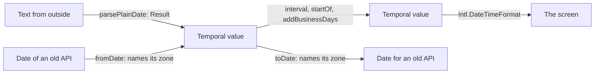

# Dates: what Temporal does not provide

`import { contains, fromDate, interval, parsePlainDate, startOf } from '@yaltaan/temporal';`

## The problem

Temporal computes dates correctly, with time zones and daylight saving, and this package does not compute them again. Temporal has no interval, reads only ISO 8601, and gives no start of a month or a week; every application writes those, and that is where its date bugs live.



## Where Temporal comes from

On Chrome, Edge, Firefox and Node 26, Temporal is native and costs nothing. On Safari, iOS, Node 22 and 24, install `temporal-polyfill` and import it once, at the start of the application: about 18 kB, once. Importing this package never needs Temporal; calling a function that builds a value does, and the error names what to install.

```ts
import 'temporal-polyfill/global';
import { parsePlainDate } from '@yaltaan/temporal';

parsePlainDate('2024-02-29').ok; // → true
```

The declarations of this package bring the types of Temporal with them: no `lib` to add, from TypeScript 6.0.

The polyfill is not the native Temporal: it misses a short daylight saving whose two ends share an offset, and answers as if the clock had not changed, in nine zones since 2000, among them `Africa/Casablanca` and `Africa/Cairo` ([the list](../../comparisons/dayjs.md)). It also keeps what it learned of each zone in memory. For a service that reads dates and zones from outside, prefer a runtime with a native Temporal.

## Intervals

An interval holds its start and not its end: January ends where February starts, and two touching intervals do not overlap. A closed end is the next value. `interval` returns a `Result`, as bounds often come from data: an inverted one is an issue, equal bounds give `emptyInterval`.

```ts
import 'temporal-polyfill/global';
import { contains, gaps, interval, mergeAll, overlaps } from '@yaltaan/temporal';

const day = (text: string) => Temporal.PlainDate.from(text);

const january = interval(day('2024-01-01'), day('2024-02-01'));
const february = interval(day('2024-02-01'), day('2024-03-01'));
const april = interval(day('2024-04-01'), day('2024-05-01'));

if (january.ok && february.ok && april.ok) {
  contains(january.value, day('2024-01-31')); // → true
  contains(january.value, day('2024-02-01')); // → false
  overlaps(january.value, february.value); // → false
  mergeAll([april.value, january.value, february.value]).ok; // → true
  gaps([january.value, april.value]).ok; // → true
}

interval(day('2024-02-01'), day('2024-01-01')).ok; // → false
```

`interval` returns a `Result`: a list takes what is inside it, and a `Result` given to a list is a `TypeError`, not an empty interval. `start` tells them apart: an interval that holds something has one, `emptyInterval` has `undefined`, and TypeScript narrows on it. `mergeAll` gives the fewest spans in order, `gaps` what lies between them, `union` and `intersect` work on two. A list of more than a million intervals is refused unread. Two values of different classes, implementations or calendars throw a `TypeError`: `compare` of Temporal would answer unevenly, and only a program can cause it.

## Reading a date

A format is declared, and what does not follow it is refused. There is no guess: without a format, only `yyyy-MM-dd` is read. A date that does not exist is refused, where `dayjs('2024-02-31')` moves to March. No issue holds a part of the text.

```ts
import 'temporal-polyfill/global';
import { parsePlainDate } from '@yaltaan/temporal';

parsePlainDate('31/12/2024', { format: 'dd/MM/yyyy' }).ok; // → true
parsePlainDate('31/02/2024', { format: 'dd/MM/yyyy' }); // → { ok: false, error: { code: 'temporal.invalid_date', path: [] } }
parsePlainDate('1/2/24', { format: 'dd/MM/yyyy' }); // → { ok: false, error: { code: 'temporal.format_mismatch', path: [], params: { at: 1 } } }
parsePlainDate('01/02/03'); // → { ok: false, error: { code: 'temporal.ambiguous_format', path: [] } }
```

A format is made of `yyyy yy MM M dd d HH H mm ss SSS` and of literal characters. `M`, `d` and `H` read one or two digits, the others exactly their width. A two-digit year says which hundred years it falls in:

```ts
import 'temporal-polyfill/global';
import { parsePlainDate } from '@yaltaan/temporal';

parsePlainDate('01/02/03', { format: 'dd/MM/yy' }); // → { ok: false, error: { code: 'temporal.ambiguous_format', path: [] } }

const read = parsePlainDate('01/02/69', { format: 'dd/MM/yy', pivotYear: 1970 });
read.ok && read.value.year; // → 2069
```

Text and format are read up to 64 code units. Temporal's own `RangeError` never leaves these functions.

## A wall clock in a zone

A wall clock may not exist, or exist twice. By default it is refused, and the application decides what it means; `dayjs.tz` answers, and which side of a repeated hour it takes depends on the day the code runs.

```ts
import 'temporal-polyfill/global';
import { parseZonedDateTime } from '@yaltaan/temporal';

const timeZone = 'America/New_York';

parseZonedDateTime('2024-03-10T02:30:00', { timeZone }); // → { ok: false, error: { code: 'temporal.nonexistent_time', path: [] } }
parseZonedDateTime('2024-11-03T01:30:00', { timeZone }); // → { ok: false, error: { code: 'temporal.ambiguous_time', path: [] } }

const decided = parseZonedDateTime('2024-03-10T02:30:00', { timeZone, disambiguation: 'compatible' });
decided.ok && decided.value.hour; // → 3
```

## The boundary with `Date`

A conversion always names its time zone: code that forgets it does not compile. The zone of the machine is never used. A name that comes from outside is a `Result`. A `ZonedDateTime` or an `Instant` needs no function: `new Date(value.epochMilliseconds)`.

```ts
import 'temporal-polyfill/global';
import { fromDate, toDate } from '@yaltaan/temporal';

const tokyo = fromDate(new Date(0), { timeZone: 'Asia/Tokyo' });
tokyo.ok && tokyo.value.hour; // → 9

fromDate(new Date(Number.NaN), { timeZone: 'Asia/Tokyo' }).ok; // → false
fromDate(new Date(0), { timeZone: 'Mars/Olympus' }); // → { ok: false, error: { code: 'temporal.invalid_time_zone', path: [] } }

const date = toDate(Temporal.PlainDate.from('2024-03-10'), { timeZone: 'UTC' });
date.ok && date.value.toISOString(); // → '2024-03-10T00:00:00.000Z'
```

## Units

`startOf` and `endOf` return the same kind of value. A week says what it starts on, as no locale decides for you. In a zone, the start of a day comes from the zone: where the clock jumps over midnight, the day starts at 01:00.

```ts
import 'temporal-polyfill/global';
import { endOf, startOf } from '@yaltaan/temporal';

const date = Temporal.PlainDate.from('2024-05-15');

startOf(date, 'quarter').toString(); // → '2024-04-01'
endOf(date, 'month').toString(); // → '2024-05-31'
startOf(date, 'week', { firstDayOfWeek: 1 }).toString(); // → '2024-05-13'
startOf(date, 'week', { firstDayOfWeek: 7 }).toString(); // → '2024-05-12'

const havana = Temporal.ZonedDateTime.from('2024-03-10T12:00:00[America/Havana]');
startOf(havana, 'day').hour; // → 1
```

To build an interval, use the next start rather than `endOf`: `endOf` is one nanosecond short of it, and is for showing.

## Business days

`weekend` and `holidays` are required, as no country is a default, and no data is embedded. A week with no working day is refused, more than a million days too, and a date beyond the range of Temporal gives `temporal.out_of_range`.

```ts
import 'temporal-polyfill/global';
import { addBusinessDays, businessDaysBetween, isBusinessDay } from '@yaltaan/temporal';

const calendar = { weekend: [6, 7], holidays: [Temporal.PlainDate.from('2024-05-01')] };
const tuesday = Temporal.PlainDate.from('2024-04-30');

isBusinessDay(tuesday, calendar); // → true
isBusinessDay(tuesday.add({ days: 1 }), calendar); // → false

const next = addBusinessDays(tuesday, { ...calendar, days: 1 });
next.ok && next.value.toString(); // → '2024-05-02'

businessDaysBetween(tuesday, tuesday.add({ days: 7 }), calendar); // → { ok: true, value: 4 }
addBusinessDays(tuesday, { weekend: [1, 2, 3, 4, 5, 6, 7], holidays: [], days: 1 }).ok; // → false
```

## What it does not do

- Time zones, daylight saving, calendars: Temporal does them.
- Formatting: `Intl.DateTimeFormat` does it, and its output follows a locale, not a pattern.
- Codecs for a schema: they wait for the codec of `@yaltaan/schema`.
- Other time zones than the platform's data: a difference in time zone data is a difference in the answer.

Moving from dayjs, with what each one answers: [the comparison](../../comparisons/dayjs.md) and [what each costs](../../comparisons/dayjs-measures.md). Every function: [the reference](../../reference/temporal.md); every issue: [the codes](../../issue-codes/temporal.md).
