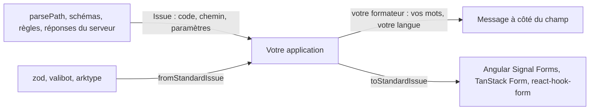

# Guide de Yaltaan

Yaltaan donne à une application les quelques briques qui manquent à la plateforme, et qui parlent toutes la même langue : une opération qui peut échouer rend un `Result`, un échec est une `Issue` avec un code stable, et chaque issue dit où elle se trouve avec un `Path`. Un parseur, un schéma, une règle métier et une réponse du serveur échouent alors de la même façon, et un seul morceau de code affiche toutes leurs erreurs.

## Disponible aujourd'hui dans `@yaltaan/core`

| Page | Import | Ce que vous obtenez | À la place de |
|---|---|---|---|
| [Résultats](result.md) | `@yaltaan/core/result` | Rendre un échec attendu comme une valeur, jamais comme une exception. | Un `try`/`catch` autour d'un code qui échoue sur une saisie fausse, un `null` qui cache la raison. |
| [Chemins](path.md) | `@yaltaan/core/path` | Désigner un endroit d'une structure, lire et écrire sa forme texte sans risque, refuser les chemins qui pollueraient un prototype. | Découper `'a.b[0]'` à la main, `lodash.toPath`. |
| [Issues](issue.md) | `@yaltaan/core/issue` | Une seule forme d'erreur pour tout, vos propres messages dans vos langues, et le pont vers les moteurs de formulaire Standard Schema. | Un format d'erreur par librairie, et le code de colle entre eux. |

Chaque export reste `@experimental` jusqu'au gel des contrats : il peut changer dans une version mineure, et le [journal des changements](../../../CHANGELOG.md) le signale en gras.

## Ce sur quoi vous pouvez compter

- **Rien ne s'exécute à l'import.** Chaque sous-chemin s'importe seul, et une application ne livre que les fonctions qu'elle utilise.
- **Aucune exception pour un échec attendu.** Une exception signale un bogue du code appelant (un argument du mauvais type, une option impossible).
- **Des bornes sur les entrées non fiables.** Les fonctions qui lisent un texte venu de l'extérieur limitent par défaut sa longueur et sa profondeur, et disent où il casse.
- **Aucun message dans la librairie.** Des codes et des données seulement : les mots appartiennent à l'application, dans toutes les langues qu'elle parle.
