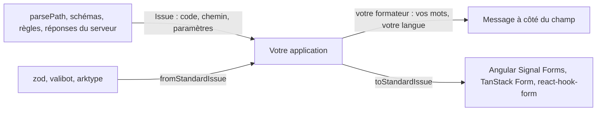

# Guide de Yaltaan

Yaltaan donne à une application les quelques briques qui manquent à la plateforme, et qui parlent toutes la même langue : une opération qui peut échouer rend un `Result`, un échec est une `Issue` avec un code stable, et chaque issue dit où elle se trouve avec un `Path`. Un parseur, un schéma, une règle métier et une réponse du serveur échouent alors de la même façon, et un seul morceau de code affiche toutes leurs erreurs.

## Disponible aujourd'hui dans `@yaltaan/core`

| Page | Import | Ce que vous obtenez | À la place de |
|---|---|---|---|
| [Résultats](result.md) | `@yaltaan/core/result` | Rendre un échec attendu comme une valeur, jamais comme une exception. | Un `try`/`catch` autour d'un code qui échoue sur une saisie fausse, un `null` qui cache la raison. |
| [Chemins](path.md) | `@yaltaan/core/path` | Désigner un endroit d'une structure, lire et écrire sa forme texte sans risque, refuser les chemins qui pollueraient un prototype. | Découper `'a.b[0]'` à la main, `lodash.toPath`. |
| [Égalité profonde](equal.md) | `@yaltaan/core/equal` | Savoir si deux valeurs contiennent les mêmes données : objets, tableaux, `Map`, `Set`, dates, tableaux typés, objets Temporal, cycles compris. | `JSON.stringify(a) === JSON.stringify(b)`, `lodash.isEqual`, `util.isDeepStrictEqual` hors de Node. |
| [Choisir des champs](object.md) | `@yaltaan/core/object` | Garder, retirer ou masquer des champs d'un objet par un masque que le compilateur vérifie, objets imbriqués et tableaux compris, sans polluer un prototype. | `lodash.pick`/`omit` avec des chemins texte, une boucle par tableau, une ligne de journal où fuit un secret renommé. |
| [Fusionner et transformer](reshape.md) | `@yaltaan/core/object` | Poser des réglages sur des valeurs par défaut à toute profondeur, combler les options absentes, transformer les valeurs ou les clés d'un objet, types gardés. | Une décomposition qui ne fusionne qu'un niveau, `lodash.merge` qui modifie son argument, `Object.fromEntries(Object.entries(x).map(…))` qui perd les types. |
| [Lire et écrire par chemin](access.md) | `@yaltaan/core/object` | Lire un endroit d'une valeur par un `Path`, ou en obtenir une copie où cet endroit est changé, retiré ou créé, le reste partagé, un champ absent distinct d'un champ `undefined`. | `a?.b?.[i]` écrit dans le code, une décomposition par niveau, `lodash.get`/`set` qui modifient leur argument et laissent des trous. |
| [Issues](issue.md) | `@yaltaan/core/issue` | Une seule forme d'erreur pour tout, vos propres messages dans vos langues, et le pont vers les moteurs de formulaire Standard Schema. | Un format d'erreur par librairie, et le code de colle entre eux. |

Chaque export reste `@experimental` jusqu'au gel des contrats : il peut changer dans une version mineure, et le [journal des changements](../../../CHANGELOG.md) le signale en gras.

## Ce sur quoi vous pouvez compter

- **Rien ne s'exécute à l'import.** Chaque sous-chemin s'importe seul, et une application ne livre que les fonctions qu'elle utilise.
- **Aucune exception pour un échec attendu.** Une exception signale un bogue du code appelant (un argument du mauvais type, une option impossible).
- **Des bornes sur les entrées non fiables.** Les fonctions qui lisent un texte venu de l'extérieur limitent par défaut sa longueur et sa profondeur, et disent où il casse.
- **Aucun message dans la librairie.** Des codes et des données seulement : les mots appartiennent à l'application, dans toutes les langues qu'elle parle.
