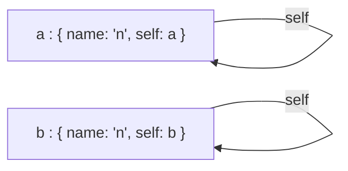

# Égalité profonde : deux valeurs contiennent-elles les mêmes données ?

`import { equal, type EqualOptions } from '@yaltaan/core/equal';`

## Le problème

`===` dit si deux objets sont le même objet, pas s'ils contiennent les mêmes données : les valeurs initiales d'un formulaire et ses valeurs courantes sont deux objets, même quand l'utilisateur n'a rien changé. `JSON.stringify(a) === JSON.stringify(b)` dépend de l'ordre des clés, perd les dates, les `Map`, les `Set`, `undefined` et `NaN`, et ne finit jamais sur une structure qui se contient elle-même. `util.isDeepStrictEqual` de Node n'existe pas dans le navigateur.

## Comparer deux valeurs

```ts
import { equal } from '@yaltaan/core/equal';

const saved = { name: 'Ada', tags: ['admin'], since: new Date(0) };
const current = { since: new Date(0), tags: ['admin'], name: 'Ada' };
equal(saved, current); // → true
equal(saved, { ...current, tags: ['admin', 'audit'] }); // → false
equal({ total: Number.NaN }, { total: Number.NaN }); // → true
```

L'ordre des clés ne compte jamais ; l'ordre des éléments d'un tableau, si.

## Ce qui est comparé, et comment

| Valeur | Égales quand |
|---|---|
| Primitives | Elles sont identiques selon SameValueZero : `NaN` égale `NaN`, `0` égale `-0` (voir plus bas pour distinguer les zéros). |
| Objets simples (et objets créés par `Object.create(null)`) | Ils ont les mêmes clés propres, énumérables, de type chaîne, qui portent des valeurs égales. Une clé qui vaut `undefined` reste une clé. |
| Tableaux | Même longueur, éléments égaux à chaque indice. Un trou diffère de `undefined`. |
| `Map` | Même taille, les mêmes clés (telles que `has` les trouve), des valeurs égales. |
| `Set` | Même taille, les mêmes éléments (tels que `has` les trouve). |
| `Date` | Même valeur de temps ; deux dates invalides sont égales. |
| Tableaux typés (`Uint8Array`…) | Même type, même longueur, nombres égaux. |
| Objets Temporal | Leur propre `equals` le dit ; un `Temporal.Duration`, qui n'en a pas, a les mêmes dix champs. |
| Tout le reste : instances de classe, fonctions, `RegExp`, `ArrayBuffer`… | C'est le même objet. |

Un `Set` contient les objets par identité : deux ensembles d'objets ne sont égaux que s'ils contiennent les mêmes objets. C'est ce que `Set` lui-même entend par « le même élément ».

```ts
import { equal } from '@yaltaan/core/equal';

equal(new Map([['fr', { label: 'Français' }]]), new Map([['fr', { label: 'Français' }]])); // → true
equal(new Set(['a', 'b']), new Set(['b', 'a'])); // → true
equal(new Set([{ id: 1 }]), new Set([{ id: 1 }])); // → false
equal({ draft: undefined }, {}); // → false
```

Une instance de classe se compare par identité, parce que seule sa classe sait ce qui rend deux instances identiques : appelez sa propre méthode, ou comparez les données qu'elle contient.

## Options

```ts
import { equal } from '@yaltaan/core/equal';

equal(0, -0); // → true
equal(0, -0, { equality: 'SameValue' }); // → false
const id = Symbol('id');
equal({ [id]: 1 }, { [id]: 2 }); // → true
equal({ [id]: 1 }, { [id]: 2 }, { symbols: true }); // → false
```

- `equality: 'SameValue'` compare les primitives comme `Object.is`, donc `0` et `-0` diffèrent (utile pour une valeur qui servira de diviseur).
- `symbols: true` compare aussi les clés symboles propres et énumérables des objets simples ; par défaut elles sont ignorées, comme par toutes les fonctions d'objet de Yaltaan.

## Les structures qui se contiennent elles-mêmes

Deux valeurs sont égales quand les parcourir côte à côte ne trouve jamais de différence. Une structure qui se désigne elle-même se compare donc sans boucler à l'infini, et une branche partagée par plusieurs endroits n'est comparée qu'une fois.



```ts
import { equal } from '@yaltaan/core/equal';

const a: Record<string, unknown> = { name: 'n' };
a['self'] = a;
const b: Record<string, unknown> = { name: 'n' };
b['self'] = b;
equal(a, b); // → true
```

Les structures très profondes (des dizaines de milliers de niveaux) se comparent sans faire déborder la pile d'appels.

## Ce que ça coûte

`equal` seul pèse moins de 1 Ko, minifié et compressé par brotli. Comparer deux petites valeurs (les données d'un formulaire) n'alloue aucune table en mémoire ; une table des paires déjà comparées n'apparaît qu'au-delà de quelques dizaines d'objets, là où elle commence à faire gagner du temps.
