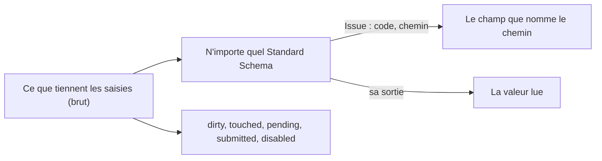

# Formulaires : des valeurs, des issues et des états qui se suivent seuls

`import { createForm, field, group } from '@yaltaan/form';`

## Le problème

Un formulaire garde plus que des valeurs : ce que l'utilisateur a changé, les champs qu'il a visités, s'il a déjà tenté d'envoyer, quel champ est désactivé, ce qu'une vérification lente du serveur n'a pas encore répondu, et chaque erreur à côté de son champ. Tenu à la main, chacun de ces états est un drapeau que quelqu'un oublie de mettre à jour, et un champ qui montre une erreur qu'il n'a plus.



## Ce que vous écrivez

Décrivez les champs et les groupes, puis construisez le formulaire. Un schéma lit la valeur brute d'un nœud : mettez-en un sur tout le formulaire, sur un groupe ou sur un champ. Chaque issue va au nœud le plus profond que nomme son chemin.

```ts
import { createForm, field, group } from '@yaltaan/form';
import { object, string } from '@yaltaan/schema';

const form = createForm(
  group(
    {
      name: field('', { schema: string({ minLength: 2 }) }),
      address: group({ city: field(''), zip: field('') }),
    },
    { schema: object({ name: string(), address: object({ city: string({ minLength: 1 }), zip: string() }) }) },
  ),
);

const { name, address } = form.children;
name.set('Ada');
address.children.city.issues.get(); // → [{ code: 'schema.too_short', path: ['address', 'city'], params: { length: 0, minimum: 1 } }]
address.set({ city: 'Paris', zip: '75001' });
form.raw.get(); // → { name: 'Ada', address: { city: 'Paris', zip: '75001' } }
form.parsed.get(); // → { ok: true, value: { name: 'Ada', address: { city: 'Paris', zip: '75001' } } }
```

Chaque valeur et chaque état est un nœud du graphe du formulaire, avec `get()` et `subscribe(listener)`, le contrat de `useSyncExternalStore` de React, qui se convertit en signal Angular ou en ref Vue comme le montre la page des [valeurs réactives](reactive.md).

## Les états

| État | D'un champ | D'un groupe |
|---|---|---|
| `raw` | Ce que tient sa saisie. | L'objet des valeurs brutes de ses enfants. |
| `parsed` | La valeur lue : `{ ok: true, value }`, ou `{ ok: false, error }` avec les issues du nœud et de tout ce qui est en dessous, tant qu'il y en a une ou que le nœud est en attente. | La même chose, sur ses enfants. |
| `issues` | Les issues placées sur lui, le schéma le plus extérieur d'abord. | Seulement celles placées sur le groupe lui-même. |
| `dirty` | Sa valeur brute diffère de sa valeur initiale, comparée par `equal` (une liste, une date par leur contenu). | Un champ en dessous est modifié. |
| `touched` | `touch()` a été appelé depuis sa dernière remise à zéro. | Un champ en dessous est touché. |
| `pending` | Un schéma qui peut placer des issues sur lui, le sien, celui d'un ancêtre ou d'un descendant, n'a pas encore répondu. | La même chose. |
| `submitted` | `submit()` a été appelé sur le formulaire depuis sa dernière remise à zéro. | La même chose, un seul nœud pour tout le formulaire. |
| `disabled` | Sa condition `disabled` tient, ou son parent est désactivé. | La même chose. |

`dirty` suit la valeur : remis à sa valeur initiale, un champ redevient propre, ce dont un avertissement « modifications non enregistrées » a besoin.

```ts
import { createForm, field, group } from '@yaltaan/form';

const form = createForm(group({ roles: field(['billing']), note: field('') }));
form.children.roles.set(['billing', 'sales']);
form.dirty.get(); // → true
form.children.roles.set(['billing']);
form.dirty.get(); // → false
```

## Écrire, remettre à zéro, envoyer

- `set(raw)` écrit un champ, ou chaque champ d'un groupe depuis l'objet donné, chaque valeur lue une fois, en un seul lot ; un groupe qui reçoit autre chose qu'un objet lève une `TypeError` et n'écrit rien.
- `touch()` marque un champ, ou chaque champ d'un groupe, comme touché : appelez-la quand une saisie perd le focus.
- `reset()` rend les valeurs initiales et marque non touché ; `reset(raw)` fait d'abord de `raw` la nouvelle valeur initiale, par exemple après un enregistrement (`reset(undefined)` vaut `reset()`). Sur la racine, elle efface aussi `submitted`.
- `submit()` touche chaque champ, marque le formulaire comme envoyé, et rend sa valeur lue : envoyez-la quand elle est `ok`.

```ts
import { createForm, field, group } from '@yaltaan/form';
import { string } from '@yaltaan/schema';

const form = createForm(group({ email: field('', { schema: string({ minLength: 3 }) }) }));
form.submit().ok; // → false
form.children.email.touched.get(); // → true
form.children.email.set('ada@example.org');
form.submit(); // → { ok: true, value: { email: 'ada@example.org' } }
form.reset(form.raw.get());
form.dirty.get(); // → false
form.submitted.get(); // → false
```

## Un champ désactivé par d'autres

Une condition nomme les chemins qu'elle lit, depuis la racine du formulaire, et dit si le nœud est désactivé. Tout ce qui est sous un groupe désactivé l'est aussi.

```ts
import { createForm, field, group } from '@yaltaan/form';

const form = createForm(
  group({
    sameAsHeadOffice: field(true),
    billing: group({ city: field('') }, { disabled: { reads: [['sameAsHeadOffice']], when: (same) => same === true } }),
  }),
);
form.children.billing.children.city.disabled.get(); // → true
form.children.sameAsHeadOffice.set(false);
form.children.billing.children.city.disabled.get(); // → false
```

Pour l'instant, `disabled` ne change rien d'autre : les issues d'un nœud désactivé comptent toujours, et sa valeur reste dans la valeur lue.

## Des listes dont les lignes bougent

`array(element, options)` décrit une liste : chaque élément est un nœud construit à partir d'`element`, un champ, un groupe ou une autre liste. Un élément garde une clé tant qu'il vit, et son chemin finit par `{ key }`, si bien que ses états et les issues placées sur lui le suivent quand il bouge. Le formulaire numérote ses éléments à partir de 0 dans l'ordre où il les construit. Avec `identity`, le chemin d'une clé métier dans un élément, les écritures et les issues retrouvent un élément par la clé que porte sa valeur.

```ts
import { array, createForm, field, group } from '@yaltaan/form';
import { array as list, object, string } from '@yaltaan/schema';

const form = createForm(
  group(
    { contacts: array(group({ email: field('') }), { initial: [{ email: 'ada@example.org' }, { email: '' }] }) },
    { schema: object({ contacts: list(object({ email: string({ minLength: 3 }) })) }) },
  ),
);
const contacts = form.children.contacts;
const empty = contacts.items.get()[1]!;
empty.children.email.issues.get().map((issue) => issue.path); // → [['contacts', { key: 1 }, 'email']]
contacts.move(empty, 0);
empty.children.email.issues.get().map((issue) => issue.path); // → [['contacts', { key: 1 }, 'email']]
contacts.dirty.get(); // → true
const added = contacts.insert(2, { email: 'grace@example.org' });
added.path; // → ['contacts', { key: 2 }]
contacts.remove(contacts.items.get()[1]!); // → true
contacts.raw.get(); // → [{ email: '' }, { email: 'grace@example.org' }]
```

- `insert(index, raw?)` construit un élément à partir de `raw`, ou de la valeur initiale de l'élément décrit, et le rend ; `remove(item)` et `move(item, index)` disent si l'élément était là. Un index hors limites lève une `RangeError`, une valeur qui ne va pas à l'élément une `TypeError` : rien n'est écrit.
- `set(list)` garde les éléments par position, ou avec `identity` l'élément qui porte la clé de chaque valeur ; une valeur de reste construit un élément, un élément de reste est retiré. `reset()` rend les éléments de la dernière remise à zéro, dans leur ordre.
- `dirty` compare la valeur brute de la liste à sa valeur initiale : une ligne déplacée la rend modifiée, remise en place elle ne l'est plus.
- Un schéma de la liste nomme un élément par son index dans la valeur qu'il a lue : l'issue va à cet élément, son index remplacé par la `{ key }` de l'élément. Le schéma de l'élément, sur chaque élément, n'est pas interrogé de nouveau quand l'élément bouge.
- Une condition dans un élément lit un champ du même élément par `{ key: undefined }`, que `@yaltaan/rules` appelle `anyElement` : `{ reads: [['contacts', { key: undefined }, 'primary']], when: (primary) => primary === true }`.
- Une liste tient au plus `maxLength` éléments, 1 000 par défaut, et une écriture lit au plus `maxItems` éléments de tout le formulaire, 10 000 par défaut (une option de `createForm`) : au-delà de l'une ou l'autre, l'écriture lève une `RangeError` et n'écrit rien.

## Un schéma qui répond plus tard

Un Standard Schema peut répondre par une promesse, une vérification du serveur par exemple. Les nœuds sur lesquels il peut placer des issues sont `pending` jusqu'à sa réponse, et leur valeur lue n'est pas `ok` entre-temps. La réponse pour une valeur que l'utilisateur a remplacée depuis n'est jamais livrée, quel que soit l'ordre d'arrivée des réponses.

```ts
import { createForm, field } from '@yaltaan/form';
import type { StandardSchema } from '@yaltaan/schema';

const taken: StandardSchema<unknown, string> = {
  '~standard': {
    version: 1,
    vendor: 'app',
    validate: async (value) =>
      value === 'ada' ? { issues: [{ message: 'This name is taken' }] } : { value: String(value) },
  },
};

const login = createForm(field('ada', { schema: taken }));
login.pending.get(); // → true
await new Promise<void>((resolve) => {
  const stop = login.pending.subscribe(() => {
    stop();
    resolve();
  });
});
login.pending.get(); // → false
login.issues.get().map((issue) => issue.params?.['message']); // → ['This name is taken']
```

Une promesse rejetée, un serveur injoignable par exemple, place `form.validation_failed` sur le nœud, avec la raison dans `cause` : la valeur lue n'est pas `ok`, et le formulaire a une issue à montrer. De même pour un schéma qui échoue sans issue.

Une issue d'un autre moteur porte le code `issue.external`, son message dans `params.message` ; un schéma de `@yaltaan/schema` garde ses propres codes et données, pour votre formateur.

## Recette : montrer une erreur de façon accessible

Montrez les issues d'un champ une fois qu'il a été touché ou le formulaire envoyé, par votre formateur. Le balisage vous appartient ; gardez le message lié à sa saisie et annoncé, jamais porté par la seule couleur : `aria-invalid="true"` sur la saisie tant qu'il y a une erreur, `aria-describedby` qui désigne le message, et le message dans une zone annoncée (`aria-live`).

```ts
import { createForm, field, group, type FormNode } from '@yaltaan/form';
import type { Issue } from '@yaltaan/core/issue';
import { string } from '@yaltaan/schema';

const words = (issue: Issue): string => (issue.code === 'schema.too_short' ? 'Too short' : issue.code);

function shown(node: FormNode<unknown, unknown>): string[] {
  return node.touched.get() || node.submitted.get() ? node.issues.get().map(words) : [];
}

const form = createForm(group({ name: field('', { schema: string({ minLength: 2 }) }) }));
shown(form.children.name); // → []
form.children.name.touch();
shown(form.children.name); // → ['Too short']
```
