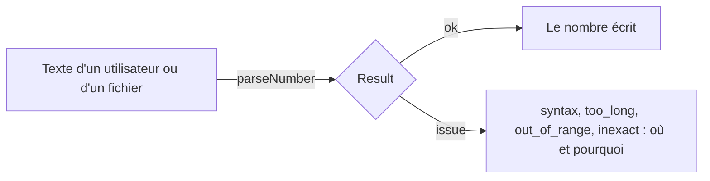

# Nombres : lire strictement, borner, comparer, arrondir, convertir

`import { parseNumber, clamp, inRange, approxEqual, round, bigIntToNumber, numberToBigInt } from '@yaltaan/core/number';`

## Le problème

`parseFloat('12abc')` donne 12, `Number('')` donne 0 et `Number(' 12 ')` donne 12 : un champ de formulaire qui contient une faute de frappe devient un nombre sans rien dire. `Number('9007199254740993')` donne 9007199254740992, un identifiant changé en silence. Un utilisateur français qui tape `1,5` dans un formulaire anglais obtient 15 d'un code qui retire les séparateurs de groupes. `Math.round(1.005 * 100) / 100` donne 1, parce que `1.005 * 100` vaut 100.49999999999999. Et `Number(2n ** 53n + 1n)` arrondit un `bigint` sans un mot.



## Lire un nombre

```ts
import { parseNumber } from '@yaltaan/core/number';

parseNumber('-1234.5'); // → { ok: true, value: -1234.5 }
parseNumber('12abc'); // → { ok: false, error: { code: 'number.syntax', path: [], params: { index: 2 } } }
parseNumber(''); // → { ok: false, error: { code: 'number.syntax', path: [], params: { index: 0 } } }
parseNumber('1 234,5', { decimal: ',', grouping: ' ' }); // → { ok: true, value: 1234.5 }
parseNumber('1,5', { grouping: ',' }).ok; // → false
parseNumber('9007199254740993'); // → { ok: false, error: { code: 'number.inexact', path: [], params: { digits: 16 } } }
```

Le texte est lu en entier : pas d'espace, pas de `+`, pas de `0x`, pas d'`Infinity`, des chiffres des deux côtés du séparateur décimal. Les séparateurs sont explicites : `'.'` pour la décimale par défaut et aucun séparateur de groupes, si bien que `1,5` n'est jamais lu 15 par accident. Avec un séparateur de groupes, les groupes sont de trois chiffres à partir du séparateur décimal, le premier ne commençant pas par 0, ou il n'y en a pas : `0,123` est une décimale d'une autre langue, jamais 123. Un texte qui dit plus que ce qu'un nombre retient est refusé : trop grand, trop petit, ou plus de chiffres significatifs qu'il n'en garde.

Pour lire ce qu'écrit une langue, prendre ses séparateurs dans `Intl.NumberFormat` :

```ts
import { parseNumber } from '@yaltaan/core/number';

const parts = new Intl.NumberFormat('fr-FR').formatToParts(1234.5);
const separator = (type: string): string => parts.find((part) => part.type === type)!.value;
parseNumber('1\u202F234,5', { decimal: separator('decimal'), grouping: separator('group') }); // → { ok: true, value: 1234.5 }
```

Le français écrit ses groupes avec une espace fine insécable (U+202F) ; un utilisateur peut taper une espace ordinaire : la remplacer avant la lecture si le champ accepte les deux. Tout nombre écrit par `String(x)`, ou par `Intl.NumberFormat` avec `maximumSignificantDigits: 17` dans une langue aux chiffres ASCII et aux groupes de trois, se relit en le même nombre.

## Bornes

```ts
import { clamp, inRange } from '@yaltaan/core/number';

clamp(12, { min: 0, max: 10 }); // → 10
clamp(-3, { min: 0 }); // → 0
inRange(10, { min: 0, max: 10 }); // → true
inRange(10, { min: 0, max: 10, exclusive: 'max' }); // → false
```

Les bornes sont nommées, chacune facultative, et l'intervalle est fermé sauf si `exclusive` dit `'min'`, `'max'` ou `'both'`. Une borne `NaN`, ou un `min` au-dessus de `max`, est une erreur du code appelant : un `RangeError`.

## Presque égal

```ts
import { approxEqual } from '@yaltaan/core/number';

0.1 + 0.2 === 0.3; // → false
approxEqual(0.1 + 0.2, 0.3, { relative: 1e-9 }); // → true
approxEqual(1e-12, 0, { relative: 1e-9 }); // → false
approxEqual(1e-12, 0, { relative: 1e-9, absolute: 1e-9 }); // → true
```

Il n'y a pas de tolérance par défaut : celle qui convient aux nombres proches de 1 est fausse près de 0 ou d'un milliard. Une tolérance relative est une fraction, de 0 à 1, du plus grand des deux nombres ; près de zéro, ajouter une tolérance absolue.

## Arrondir

```ts
import { round } from '@yaltaan/core/number';

round(1.005, { digits: 2, mode: 'halfExpand' }); // → 1.01
round(2.345, { digits: 2, mode: 'halfEven' }); // → 2.34
round(-2.5, { mode: 'halfCeil' }); // → -2
round(1234, { digits: -2, mode: 'floor' }); // → 1200
```

`round` arrondit la décimale qu'écrit `String`, celle qu'une personne lit, comme l'arrondit `Intl.NumberFormat` : `1.005` donne 1.01, là où `toFixed` donne `'1.00'`. Le mode est toujours donné, sous les noms d'`Intl.NumberFormat` : `ceil`, `floor`, `expand` (en s'éloignant de zéro), `trunc` (vers zéro), et `halfCeil`, `halfFloor`, `halfExpand`, `halfTrunc`, `halfEven` pour le plus proche, une égalité allant vers le haut, vers le bas, loin de zéro, vers zéro ou au chiffre pair. Le résultat est le nombre le plus proche de la décimale arrondie : pour de l'argent, calculer en centimes entiers ou avec une librairie décimale.

## Entre `number` et `bigint`

```ts
import { bigIntToNumber, numberToBigInt } from '@yaltaan/core/number';

bigIntToNumber(2n ** 60n); // → { ok: true, value: 1152921504606846976 }
bigIntToNumber(2n ** 53n + 1n).ok; // → false
numberToBigInt(2 ** 60); // → { ok: true, value: 1152921504606846976n }
numberToBigInt(1.5); // → { ok: false, error: { code: 'number.not_integer', path: [] } }
```

Chaque conversion est exacte ou dit pourquoi elle ne l'est pas : un `bigint` entre deux nombres donne `number.inexact`, un au-delà d'eux `number.out_of_range`, et une fraction, `NaN` ou un infini n'a pas de `bigint`.

## Bon à savoir

- `parseNumber` lit au plus 1 000 unités de code par défaut (`maxLength`), en une passe et sans expression régulière : son temps est proportionnel à la longueur.
- `-0` se lit `-0`, et `round` garde le signe d'une valeur arrondie à zéro : `round(-0.4, { mode: 'halfExpand' })` vaut `-0`.
- Les chiffres autres qu'ASCII (arabes-indiens, pleine chasse) et les groupes de l'Inde (`12,34,567`) ne sont pas encore lus.
