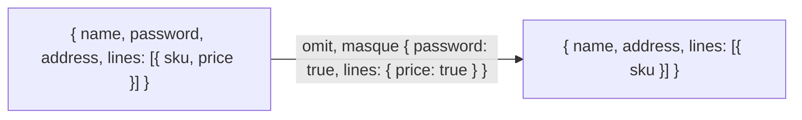

# Choisir des champs : pick, omit et redact par un masque

`import { pick, omit, redact, type Mask } from '@yaltaan/core/object';`

## Le problème

Une application réécrit sans cesse les trois mêmes fonctions : garder seulement certains champs d'un objet (ce qu'un écran ou une réponse d'API demande), en retirer (un mot de passe avant d'envoyer un utilisateur au navigateur), en masquer (un numéro de carte avant d'écrire un journal). Les versions habituelles prennent une liste de noms de clés, sur un seul niveau : un champ imbriqué demande un appel par niveau, un champ dans chaque élément d'un tableau demande une boucle, et un champ renommé dans le modèle cesse d'être retiré sans que rien ne le dise. Un secret part alors dans un journal, et rien n'échoue.

## Un masque, de la forme de la valeur

Un masque nomme les champs comme la valeur les imbrique : `true` prend un champ entier, un masque imbriqué entre dedans, et un masque posé sur un tableau s'applique à chacun de ses éléments.



```ts
import { omit, pick, redact } from '@yaltaan/core/object';

const user = {
  name: 'Ada',
  password: 's3cret',
  address: { city: 'Paris', zip: '75001' },
  lines: [{ sku: 'a', price: 3 }],
};
omit(user, { password: true, lines: { price: true } }); // → { name: 'Ada', address: user.address, lines: [{ sku: 'a' }] }
pick(user, { name: true, address: { city: true } }); // → { name: 'Ada', address: { city: 'Paris' } }
redact(user, { password: true }); // → { ...user, password: '***' }
redact(user, { password: true }, { replacement: null }); // → { ...user, password: null }
```

## Le compilateur vérifie chaque champ

Les clés d'un masque sont vérifiées contre le type de la valeur, à toute profondeur et dans les tableaux. Votre éditeur propose les vrais champs pendant la saisie, et un champ mal orthographié ou renommé est une erreur de compilation, même à côté d'un champ juste. Le résultat a le type de ce qui reste : après `omit(user, { password: true })`, lire `.password` ne compile pas.

```ts
import { omit, type Mask } from '@yaltaan/core/object';

interface User {
  readonly name: string;
  readonly password: string;
  readonly address: { readonly city: string };
}
const ada: User = { name: 'Ada', password: 's3cret', address: { city: 'Paris' } };

const safe = omit(ada, { password: true }); // → { name: 'Ada', address: { city: 'Paris' } }
// @ts-expect-error le mot de passe n'y est plus
void safe.password;
// @ts-expect-error « passwrd » n'est pas un champ de User, et le compilateur le dit
const wrong = (): unknown => omit(ada, { name: true, passwrd: true });
const reusable: Mask<User> = { address: { city: true } };
```

Sur une valeur de type `unknown` (une donnée tout juste lue depuis du JSON), toute clé est permise ; les fonctions vérifient quand même à l'exécution que le masque n'est fait que de `true` et d'objets simples.

## Ce qui est parcouru, et ce qui est pris entier

| Valeur | Ce que fait un masque |
|---|---|
| Objets simples (et objets créés par `Object.create(null)`) | Choisit parmi leurs clés texte propres et énumérables ; la copie garde le prototype, si bien qu'un dictionnaire sans prototype le reste. |
| Tableaux | Applique le masque à chaque élément ; les trous restent des trous. |
| Tout le reste : `Map`, `Set`, dates, instances de classe, fonctions… | Prend la valeur entière. Le compilateur n'accepte que `true` pour une date ou une `Map`. |

```ts
import { omit } from '@yaltaan/core/object';

const parsed = JSON.parse('{ "__proto__": { "isAdmin": true }, "name": "Ada" }') as unknown;
const copy = omit(parsed, {}); // → JSON.parse('{ "__proto__": { "isAdmin": true }, "name": "Ada" }')
(copy as { isAdmin?: boolean }).isAdmin; // → undefined
```

Une clé `"__proto__"` dans les données reste une clé ordinaire de la copie : elle ne devient jamais son prototype, et rien n'atteint `Object.prototype`, quelles que soient les clés de la valeur ou du masque.

- Un accesseur (getter) est lu une fois, et seulement quand son champ est gardé ; ce qu'il lève vous parvient tel quel.
- Les clés symboles sont ignorées sauf avec `{ symbols: true }`, comme pour toutes les fonctions d'objet de Yaltaan.
- Ce que le masque ne parcourt pas est partagé avec la valeur, pas copié : `omit(user, { password: true }).address === user.address`.
- Un masque peut se désigner lui-même, pour parcourir un arbre (`mask.children = mask`).

## Comparer seulement certains champs

`equal` prend les mêmes masques, pour comparer tous les champs sauf certains, ou seulement certains : voir [l'égalité profonde](equal.md#comparer-seulement-certains-champs).

## Ce que ça coûte

`omit` seul pèse environ 530 octets minifié et compressé par brotli, `pick`, `omit` et `redact` ensemble environ 630 ; le `omit` d'es-toolkit, qui ne retire des clés que sur un niveau, pèse 90 octets, et son `omit` compatible lodash, qui suit des chemins imbriqués, 2 741. Chaque appel ne va pas plus loin que le masque, et lit une fois chaque champ gardé.
