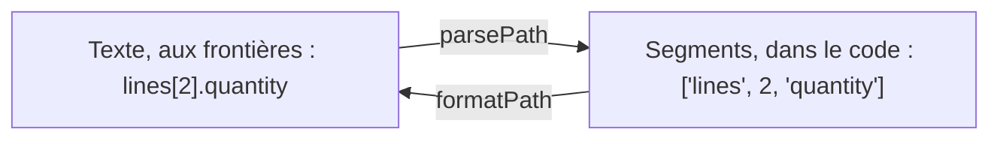

# Chemins : désigner un endroit de vos données

`import { checkWritablePath, formatPath, parsePath, type Path } from '@yaltaan/core/path';`

## Le problème

Une erreur doit dire quel champ elle concerne : `lines[2].quantity`. Ce texte vient d'un nom de champ de formulaire, d'une URL ou d'une réponse du serveur, et le découper à la main casse à la première clé qui contient un point ou un crochet. Pire, un chemin lu de l'extérieur et utilisé pour écrire (`user.__proto__.isAdmin`) peut modifier tous les objets de l'application.

## Deux formes, un seul chemin

Dans votre code, un chemin est un tableau de segments ; le texte n'existe qu'aux échanges avec l'extérieur.



```ts
import { formatPath, parsePath } from '@yaltaan/core/path';

parsePath('lines[2].quantity'); // → { ok: true, value: ['lines', 2, 'quantity'] }
parsePath('lines[2]["unit price"]'); // → { ok: true, value: ['lines', 2, 'unit price'] }
formatPath(['lines', 2, 'unit price']); // → { ok: true, value: 'lines[2]["unit price"]' }
formatPath([]); // → { ok: true, value: '' }
```

## La grammaire du texte

| Vous écrivez | Segment | Exemple |
|---|---|---|
| Un nom fait de lettres ASCII, de chiffres, de `_` et de `$`, qui ne commence pas par un chiffre | la chaîne | `lines`, `$id`, `_meta` |
| Un nombre entier entre crochets | le nombre | `[0]`, `[42]` |
| Toute autre clé, en chaîne JSON entre crochets | la chaîne | `["unit price"]`, `["a.b"]`, `["3"]`, `["prénom"]` |

Chaque chemin a exactement une forme texte : `formatPath` puis `parsePath` rendent toujours les mêmes segments. Les accents s'écrivent entre guillemets, parce que les lettres admises dans un nom changent d'un moteur JavaScript à l'autre ; les guillemets gardent le même texte partout.

## Un texte non fiable est refusé, avec la raison

Un chemin qui sort de la grammaire n'est jamais deviné : l'issue dit où il casse.

```ts
import { parsePath } from '@yaltaan/core/path';

parsePath('lines.2'); // → { ok: false, error: { code: 'path.syntax', path: [], params: { index: 6 } } }
parsePath('a.b.c', { maxDepth: 2 }); // → { ok: false, error: { code: 'path.too_deep', path: [], params: { maximum: 2 } } }
```

Par défaut, un texte compte au plus 4 096 caractères et 64 segments, et sa lecture prend un temps proportionnel à sa longueur : un texte hostile ne peut pas figer la page ni le serveur. N'augmentez `maxLength` et `maxDepth` que pour un texte de confiance.

## Avant d'écrire par un chemin venu de l'extérieur

`__proto__`, `constructor` et `prototype` mènent à des objets que tous les autres partagent. `checkWritablePath` les refuse avant toute écriture.

```ts
import { checkWritablePath } from '@yaltaan/core/path';

const path = ['user', '__proto__', 'isAdmin'];
checkWritablePath(path); // → { ok: false, error: { code: 'path.forbidden_segment', path, params: { index: 1, segment: '__proto__' } } }
checkWritablePath(['user', 'name']); // → { ok: true, value: ['user', 'name'] }
```

## Suivre un élément de liste quand il bouge : `{ key }`

Un index change quand la liste est triée ou qu'un élément est retiré ; une erreur rattachée à `lines[1]` s'afficherait alors sur la mauvaise ligne. Un segment `{ key }` désigne l'élément par son propre identifiant : ce qui lui est rattaché le suit.

| Ordre de la liste | Erreur rattachée à `['lines', 1, 'quantity']` | Erreur rattachée à `['lines', { key: 'b2' }, 'quantity']` |
|---|---|---|
| `a7`, `b2` | ligne `b2` : juste | ligne `b2` : juste |
| `b2`, `a7` après un tri | ligne `a7` : faux | ligne `b2` : juste |

```ts
import { formatPath, type Path } from '@yaltaan/core/path';

const quantityOfB2: Path = ['lines', { key: 'b2' }, 'quantity'];
formatPath(quantityOfB2); // → { ok: false, error: { code: 'path.not_textual', path: quantityOfB2, params: { index: 1 } } }
```

Un segment `{ key }` n'a pas de forme texte ; pour le confier à un moteur de formulaire qui ne connaît que les index, convertissez l'issue avec [`toStandardIssue`](issue.md#vers-un-moteur-de-formulaire--tostandardissue), qui cherche l'index actuel de l'élément.

## Codes

Les issues de ce module (`path.syntax`, `path.too_long`, `path.too_deep`, `path.not_textual`, `path.forbidden_segment`) et leurs paramètres sont listés dans le [registre de `@yaltaan/core`](../../issue-codes/core.md).
