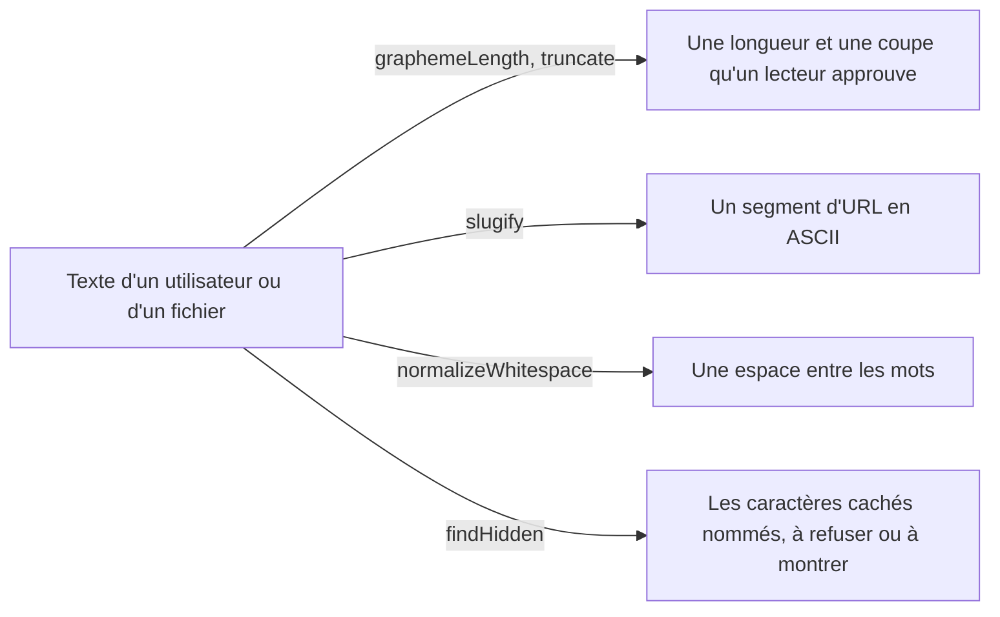

# Chaînes : graphèmes, troncature, slugs, espaces, caractères cachés

`import { graphemeLength, truncate, slugify, normalizeWhitespace, findHidden } from '@yaltaan/core/string';`

## Le problème

`length` compte des unités de code, pas ce que voit un lecteur : un emoji de famille vaut 8, un drapeau 4, un `e` suivi d'un accent combinant 2. `slice(0, 20)` coupe alors un emoji en deux, ou laisse un accent sans sa lettre. Un titre changé en URL par une expression régulière écrite à la main garde le `é` ou perd le mot entier. Un texte copié apporte des espaces insécables et des retours à la ligne dans un champ de nom. Et un nom de fichier ou d'utilisateur peut contenir des caractères que personne ne voit : un forçage de droite à gauche (U+202E) affiche `user`, U+202E, `gnp.exe` comme `userexe.png`, une espace sans chasse rend différents deux noms qui ont l'air identiques.



## Compter ce que voit un lecteur

```ts
import { graphemeLength } from '@yaltaan/core/string';

const family = '\u{1F468}\u200D\u{1F469}\u200D\u{1F467}';
family.length; // → 8
graphemeLength(family); // → 1
graphemeLength('noe\u0308l'); // → 4
graphemeLength('a\r\nb'); // → 3
```

Un graphème est ce qu'`Intl.Segmenter` appelle ainsi : une séquence d'emoji, un drapeau, une lettre et ses accents, CR LF. Un texte de lettres latines, de ponctuation et de symboles monétaires se compte en un seul passage ; tout autre passe par le segmenteur de la plateforme, construit une fois, au premier appel qui en a besoin.

## Tronquer

```ts
import { truncate } from '@yaltaan/core/string';

const family = '\u{1F468}\u200D\u{1F469}\u200D\u{1F467}';
truncate('Crème brûlée', { maxGraphemes: 8 }); // → 'Crème b…'
truncate(`ab${family}cd`, { maxGraphemes: 4 }); // → `ab${family}…`
truncate('Bonjour tout le monde', { maxGraphemes: 10, omission: '...' }); // → 'Bonjour...'
truncate('Short', { maxGraphemes: 10 }); // → 'Short'
truncate(`e${'\u0301'.repeat(100)}`, { maxGraphemes: 5, maxLength: 50 }); // → '…'
```

`truncate` garde des graphèmes entiers : jamais un demi-emoji, un accent seul ou un demi-drapeau. L'omission, `'…'` par défaut, compte dans la borne. `maxGraphemes` borne ce que voit le lecteur ; `maxLength` borne les unités de code, l'unité de `String.length` et d'une colonne de base de données : un seul graphème peut porter des milliers de marques combinantes, donc un champ rangé dans une colonne limitée prend les deux bornes. Une omission qui ne tient pas dans la borne est une `RangeError`.

## Slugs

```ts
import { slugify } from '@yaltaan/core/string';

slugify('Crème brûlée : 2 œufs'); // → 'creme-brulee-2-oeufs'
slugify('Straße, Łódź'); // → 'strasse-lodz'
slugify('fine art²'); // → 'fine-art2'
slugify('camelCase'); // → 'camelcase'
slugify('Привет'); // → ''
```

Les règles sont écrites, donc un slug ne dépend jamais d'une supposition : formes de compatibilité décomposées (NFKD : `fi` donne `fi`, `²` donne `2`), minuscules, tout accent retiré, `æ ð ø þ ß đ ħ ı ĸ ł ŋ œ ŧ` écrits `ae d o th ss d h i k l n oe t`, et toute autre suite de caractères devient un seul `-`, aucun aux deux bouts. Un slug ne contient que `a`–`z`, `0`–`9` et `-` : il tient dans une URL sans encodage en pourcentage, et le `slugify` d'un slug est le même slug. Toute autre lettre sépare, latines hors de la table comprises (`ə`, `ɓ`, `ɛ`), et un texte qui ne laisse aucune lettre ni aucun chiffre ASCII donne `''` : décidez alors ce que fait votre application, un identifiant par exemple.

## Espaces

```ts
import { normalizeWhitespace } from '@yaltaan/core/string';

normalizeWhitespace('  Jean \t\n Dupont '); // → 'Jean Dupont'
normalizeWhitespace('12\u00A0rue\u202Fdes Lilas'); // → '12 rue des Lilas'
normalizeWhitespace('a\uFEFFb'); // → 'a\uFEFFb'
```

Toute suite d'espaces au sens d'Unicode (tabulation, retours à la ligne, espaces insécables et fines insécables, espace idéographique…) devient une seule espace, et aucune ne reste aux deux bouts. Les retours à la ligne sont des espaces aussi : réservez cette fonction aux champs d'une ligne. U+FEFF n'est pas une espace mais un caractère invisible : `findHidden` le nomme.

## Caractères cachés

```ts
import { findHidden } from '@yaltaan/core/string';

findHidden('user\u202Egnp.exe'); // → [{ index: 4, codePoint: 0x202e, kind: 'bidi' }]
findHidden('admin\u200B'); // → [{ index: 5, codePoint: 0x200b, kind: 'invisible' }]
findHidden('line\u0007'); // → [{ index: 4, codePoint: 7, kind: 'control' }]
findHidden('Jean Dupont'); // → []
```

`findHidden` liste, dans l'ordre, les caractères qu'un lecteur ne voit pas ou qui réordonnent ce qu'il voit : les contrôles bidirectionnels des attaques Trojan Source (`bidi`), les autres caractères qu'Unicode demande de dessiner comme rien (`invisible` : espaces et liants sans chasse, gluon de mots, trait d'union conditionnel, sélecteurs de variante, étiquettes, U+FEFF…), et les caractères de contrôle autres que les espaces (`control`). `index` compte des unités de code, comme `slice`.

Rien n'est exempté, parce que vous seul savez ce que votre champ accepte : une séquence d'emoji contient un liant sans chasse (U+200D) et souvent un sélecteur de variante (U+FE0F), et un mot persan un antiliant sans chasse (U+200C). Pour les accepter dans un champ de texte libre et refuser le reste :

```ts
import { findHidden } from '@yaltaan/core/string';

const accepted = new Set([0x200c, 0x200d, 0xfe0f]);
const refused = (text: string) => findHidden(text).filter(({ codePoint }) => !accepted.has(codePoint));

refused('\u{1F44D}\uFE0F'); // → []
refused('pay\u202Eload'); // → [{ index: 3, codePoint: 0x202e, kind: 'bidi' }]
```

## Bon à savoir

- Chaque fonction est linéaire en la longueur du texte, quoi qu'il contienne : aucune expression régulière ici ne peut revenir en arrière.
- Un substitut isolé n'est pas un caractère caché : `isWellFormed()` le teste, et `toWellFormed()` le remplace.
- Pas encore ici : couper à une frontière de mot, retirer les caractères cachés, des slugs dans d'autres écritures ou avec l'orthographe d'une langue (l'allemand `ä` en `ae`).
