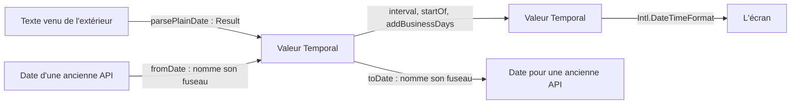

# Dates : ce que Temporal ne fournit pas

`import { contains, fromDate, interval, parsePlainDate, startOf } from '@yaltaan/temporal';`

## Le problème

Temporal calcule les dates correctement, avec les fuseaux et l'heure d'été, et ce paquet ne les recalcule pas. Temporal n'a pas d'intervalle, ne lit que l'ISO 8601 et ne donne ni le début d'un mois ni celui d'une semaine ; chaque application les écrit, et c'est là que vivent ses bogues de dates.



## D'où vient Temporal

Sur Chrome, Edge, Firefox et Node 26, Temporal est natif et ne coûte rien. Sur Safari, iOS, Node 22 et 24, installez `temporal-polyfill` et importez-le une fois, au début de l'application : environ 18 ko, une seule fois. Importer ce paquet n'a jamais besoin de Temporal ; appeler une fonction qui fabrique une valeur, si, et l'erreur dit quoi installer.

```ts
import 'temporal-polyfill/global';
import { parsePlainDate } from '@yaltaan/temporal';

parsePlainDate('2024-02-29').ok; // → true
```

Les déclarations de ce paquet apportent les types de Temporal avec elles : aucune `lib` à ajouter, à partir de TypeScript 6.0.

Le polyfill n'est pas le Temporal natif : il rate une heure d'été courte dont les deux bouts ont le même décalage, et répond comme si l'horloge n'avait pas changé, dans neuf fuseaux depuis 2000, dont `Africa/Casablanca` et `Africa/Cairo` ([la liste](../../comparisons/dayjs.md)). Il garde aussi en mémoire ce qu'il a appris de chaque fuseau. Pour un service qui lit des dates et des fuseaux venus de l'extérieur, préférez un moteur avec un Temporal natif.

## Les intervalles

Un intervalle contient son début et pas sa fin : janvier finit où février commence, et deux intervalles qui se touchent ne se recouvrent pas. Une fin fermée, c'est la valeur suivante. `interval` rend un `Result`, car les bornes viennent souvent des données : une borne inversée donne une issue, des bornes égales donnent `emptyInterval`.

```ts
import 'temporal-polyfill/global';
import { contains, gaps, interval, mergeAll, overlaps } from '@yaltaan/temporal';

const day = (text: string) => Temporal.PlainDate.from(text);

const january = interval(day('2024-01-01'), day('2024-02-01'));
const february = interval(day('2024-02-01'), day('2024-03-01'));
const april = interval(day('2024-04-01'), day('2024-05-01'));

if (january.ok && february.ok && april.ok) {
  contains(january.value, day('2024-01-31')); // → true
  contains(january.value, day('2024-02-01')); // → false
  overlaps(january.value, february.value); // → false
  mergeAll([april.value, january.value, february.value]).ok; // → true
  gaps([january.value, april.value]).ok; // → true
}

interval(day('2024-02-01'), day('2024-01-01')).ok; // → false
```

`mergeAll` donne le moins de plages possible, dans l'ordre, `gaps` ce qui se trouve entre elles, `union` et `intersect` travaillent sur deux. Une liste de plus d'un million d'intervalles est refusée sans être lue. Deux valeurs de classes, d'implémentations ou de calendriers différents lèvent une `TypeError` : `compare` de Temporal répondrait de façon inégale, et seul un programme peut le provoquer.

## Lire une date

Un format se déclare, et ce qui ne le suit pas est refusé. Rien n'est deviné : sans format, seul `yyyy-MM-dd` est lu. Une date qui n'existe pas est refusée, là où `dayjs('2024-02-31')` passe en mars. Aucune issue ne contient une partie du texte.

```ts
import 'temporal-polyfill/global';
import { parsePlainDate } from '@yaltaan/temporal';

parsePlainDate('31/12/2024', { format: 'dd/MM/yyyy' }).ok; // → true
parsePlainDate('31/02/2024', { format: 'dd/MM/yyyy' }); // → { ok: false, error: { code: 'temporal.invalid_date', path: [] } }
parsePlainDate('1/2/24', { format: 'dd/MM/yyyy' }); // → { ok: false, error: { code: 'temporal.format_mismatch', path: [], params: { at: 1 } } }
parsePlainDate('01/02/03'); // → { ok: false, error: { code: 'temporal.ambiguous_format', path: [] } }
```

Un format se compose de `yyyy yy MM M dd d HH H mm ss SSS` et de caractères littéraux. `M`, `d` et `H` lisent un ou deux chiffres, les autres exactement leur largeur. Une année sur deux chiffres dit dans quels cent ans elle tombe :

```ts
import 'temporal-polyfill/global';
import { parsePlainDate } from '@yaltaan/temporal';

parsePlainDate('01/02/03', { format: 'dd/MM/yy' }); // → { ok: false, error: { code: 'temporal.ambiguous_format', path: [] } }

const read = parsePlainDate('01/02/69', { format: 'dd/MM/yy', pivotYear: 1970 });
read.ok && read.value.year; // → 2069
```

Le texte et le format sont lus jusqu'à 64 unités de code. La `RangeError` de Temporal ne sort jamais de ces fonctions.

## Une heure dans un fuseau

Une heure peut ne pas exister, ou exister deux fois. Par défaut elle est refusée, et c'est l'application qui décide ; `dayjs.tz` répond, et le côté de l'heure doublée qu'il prend dépend du jour où le code tourne.

```ts
import 'temporal-polyfill/global';
import { parseZonedDateTime } from '@yaltaan/temporal';

const timeZone = 'America/New_York';

parseZonedDateTime('2024-03-10T02:30:00', { timeZone }); // → { ok: false, error: { code: 'temporal.nonexistent_time', path: [] } }
parseZonedDateTime('2024-11-03T01:30:00', { timeZone }); // → { ok: false, error: { code: 'temporal.ambiguous_time', path: [] } }

const decided = parseZonedDateTime('2024-03-10T02:30:00', { timeZone, disambiguation: 'compatible' });
decided.ok && decided.value.hour; // → 3
```

## La frontière avec `Date`

Une conversion nomme toujours son fuseau : le code qui l'oublie ne compile pas. Le fuseau de la machine n'est jamais utilisé. Un nom venu de l'extérieur donne un `Result`. Un `ZonedDateTime` ou un `Instant` n'a besoin d'aucune fonction : `new Date(value.epochMilliseconds)`.

```ts
import 'temporal-polyfill/global';
import { fromDate, toDate } from '@yaltaan/temporal';

const tokyo = fromDate(new Date(0), { timeZone: 'Asia/Tokyo' });
tokyo.ok && tokyo.value.hour; // → 9

fromDate(new Date(Number.NaN), { timeZone: 'Asia/Tokyo' }).ok; // → false
fromDate(new Date(0), { timeZone: 'Mars/Olympus' }); // → { ok: false, error: { code: 'temporal.invalid_time_zone', path: [] } }

const date = toDate(Temporal.PlainDate.from('2024-03-10'), { timeZone: 'UTC' });
date.ok && date.value.toISOString(); // → '2024-03-10T00:00:00.000Z'
```

## Les unités

`startOf` et `endOf` rendent le même type de valeur. Une semaine dit par quel jour elle commence, car aucune locale ne décide pour vous. Dans un fuseau, le début d'une journée vient du fuseau : là où l'horloge saute minuit, la journée commence à 01:00.

```ts
import 'temporal-polyfill/global';
import { endOf, startOf } from '@yaltaan/temporal';

const date = Temporal.PlainDate.from('2024-05-15');

startOf(date, 'quarter').toString(); // → '2024-04-01'
endOf(date, 'month').toString(); // → '2024-05-31'
startOf(date, 'week', { firstDayOfWeek: 1 }).toString(); // → '2024-05-13'
startOf(date, 'week', { firstDayOfWeek: 7 }).toString(); // → '2024-05-12'

const havana = Temporal.ZonedDateTime.from('2024-03-10T12:00:00[America/Havana]');
startOf(havana, 'day').hour; // → 1
```

Pour construire un intervalle, prenez le début suivant plutôt que `endOf` : `endOf` s'arrête une nanoseconde avant, et sert à afficher.

## Les jours ouvrés

`weekend` et `holidays` sont obligatoires, car aucun pays n'est un défaut, et aucune donnée n'est embarquée. Une semaine sans jour travaillé est refusée, plus d'un million de jours aussi, et une date au-delà de ce que Temporal sait représenter donne `temporal.out_of_range`.

```ts
import 'temporal-polyfill/global';
import { addBusinessDays, businessDaysBetween, isBusinessDay } from '@yaltaan/temporal';

const calendar = { weekend: [6, 7], holidays: [Temporal.PlainDate.from('2024-05-01')] };
const tuesday = Temporal.PlainDate.from('2024-04-30');

isBusinessDay(tuesday, calendar); // → true
isBusinessDay(tuesday.add({ days: 1 }), calendar); // → false

const next = addBusinessDays(tuesday, { ...calendar, days: 1 });
next.ok && next.value.toString(); // → '2024-05-02'

businessDaysBetween(tuesday, tuesday.add({ days: 7 }), calendar); // → { ok: true, value: 4 }
addBusinessDays(tuesday, { weekend: [1, 2, 3, 4, 5, 6, 7], holidays: [], days: 1 }).ok; // → false
```

## Ce qu'il ne fait pas

- Les fuseaux, l'heure d'été, les calendriers : Temporal les fait.
- Le formatage : `Intl.DateTimeFormat` le fait, et sa sortie suit une locale, pas un motif.
- Les codecs d'un schéma : ils attendent le codec de `@yaltaan/schema`.
- D'autres fuseaux que les données de la plateforme : une différence de données de fuseau est une différence de réponse.

Pour quitter dayjs, avec ce que chacun répond : [la comparaison](../../comparisons/dayjs.md) et [ce que chacun coûte](../../comparisons/dayjs-measures.md). Chaque fonction : [la référence](../../reference/temporal.md) ; chaque issue : [les codes](../../issue-codes/temporal.md).
